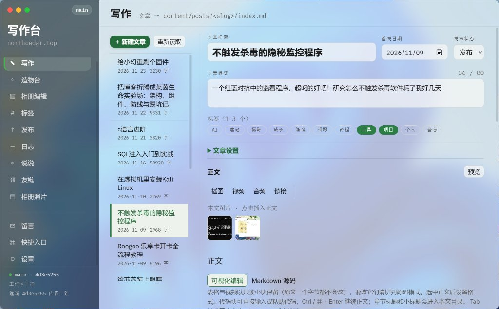

写静态博客最烦的其实不是写字，是写完之后那一堆仪式感。打开编辑器、找文件夹、手敲 frontmatter、算相对图片路径，写几百字随笔还得跑一遍构建和测试再 `git push`，搞得跟发正式版本一样。

忍了一阵子之后我干脆自己写了个本地桌面小工具，叫「写作台」。仓库扔 GitHub 上了，源码在这：[NorthenCedar/blog-desk](https://github.com/NorthenCedar/blog-desk)。

先说一下手感：写文章、加置顶、发说说、改友链、管相册和删留言全塞在一个小窗口里，左下角还实时盯着 git 状态跟远端是否一致，写完直接点发布就能校验加推送。自己搓顺手了之后，真的觉得这超牛的好吧！

## 整体怎么搭起来的

一开始最偷懒的想法是上 Electron，但仔细一想，写个 Markdown 打包两三百兆进去纯属杀鸡用牛刀。最后选了特别素的一套组合：

- **本地服务**：Python 标准库的 `ThreadingHTTPServer`，只监听 `127.0.0.1` 的随机端口，连 Flask/FastAPI 都没引。所有读写 `content/`、处理图片、调 `git` 和跑 `npm run verify` 的活全在服务端完成，前端只通过 `/api/*` 收发 JSON。
- **桌面壳子**：用 `pywebview` 调 Windows 自带的 WebView2 来当窗口，等于白嫖系统里现成的 Chromium 内核，打包出来的整套目录体积压得很小。
- **前端界面**：纯原生 HTML + CSS + JS，完全没搞前端构建流水线。样式直接复刻博客自己的墨绿配纸白，顺便让编辑器里的字体和排版跟线上长得尽量像。

我还嫌普通 Windows 标题栏太丑，干脆做成了无边框窗口，自己画了左上角三个仿 macOS 红绿灯按钮。侧边栏的半透明磨砂也不是纯 CSS `backdrop-filter` 假装的，而是在 `lib/window_chrome.py` 里直接调 DWM API（`DwmSetWindowAttribute` 开 `DWMSBT_TRANSIENTWINDOW` 加上 `DwmExtendFrameIntoClientArea`），把系统桌面真透出来；因为无边框窗口最大化时会顺便盖住任务栏，又接了 `WM_GETMINMAXINFO` 消息子类化窗口过程去修正工作区边界。桌面端这层亚克力配上侧栏，效果比想象中自然得多。

## 正文编辑和防呆机制

正文这块一开始就是个大 `<textarea>`，写着写着还是觉得有个所见即所得更舒服，就把博客云端写作台同款的 ProseMirror 编辑器打包进了本地资源目录，能直接在可视化界面里写，也能一键切回 Markdown 源码。表格和 `
` 里的视频标签之类比较容易被编辑器揉碎的结构，在可视化模式下会锁成只读小块保留原字节，只有切源码才会让你改。

在文件读写方面踩过不少奇葩需求，干脆往后端里写了几条硬防呆规则：

1. **不能直接整篇序列化 YAML**：`talks.md` 和 `log.md` 开头留着一堆 `#` 注释写法说明，直接 `yaml.safe_load` 再 `dump` 回去注释就没了。所以写了个专门的定点重写逻辑加上手写标量转义函数 `yaml_scalar`——遇到文本里夹了 `:` 加空格（会被 YAML 当成字典，前端直接印出 `[object Object]`）或者换行符、制表符时才自动包双引号转义，日常纯中文不动它，git diff 干净得很。
2. **乐观并发锁防覆盖**：我经常一边开着写作台，一边让 AI 在仓库里改东西，一不小心就会旧版本盖新版本。于是每次读取文章或说说都会带上文件内容的 SHA-256 作为 `revision`，写入前先用临时文件写完 `fsync`，紧贴 `os.replace` 前再核对一遍磁盘上的哈希变没变，撞了就直接报冲突停手。
3. **更新日期只进不退**：以前老忘了改 `updated` 字段，现在后台比较正文和字段确实有实质改动且原文带有 `updated` 时，才顺手把它往今天推，而且只进不退，也不会给没打算显示更新时间的文章强行加上这个字段。
4. **发布门禁和快照核对**：点「推送」不是上来就 `git add .`，而是只收集写作台管辖路径下的改动，先跑通博客仓库里的 `npm run verify`（Astro 构建加上全套 Vitest 测试），记下构建瞬间的文件 blob SHA 快照；如果校验期间工作区又被人动过，或者最后打进 commit 的树和快照对不上，立刻拦下来停在原地，坚决不瞎强推。

## 打包成 exe 遇到的几个离谱坑

本来以为写完 `app.py` 用 PyInstaller 一打就完事了，结果真正卡人时间全在环境问题上：

- **WebView2 启动卡死 20 秒**：不提前处理的话，`pywebview` 在这台机器上启动时经常等半分钟然后直接超时崩掉。后来查明白，必须在 `import webview` 之前手动定位到包目录下的 `Microsoft.Web.WebView2.Core.dll` 和 `Microsoft.Web.WebView2.WinForms.dll`，用 `clr.AddReference` 提前加载进去才稳。同时还是留了兜底：万一哪天窗口没能正常拉起服务请求，超时后自动切系统浏览器打开同一个本地地址，起码不耽误干活。
- **JS 桥递归把 .NET 控件摸炸了**：早期窗口刚开就概率性卡死。翻完报错才知道，Window 对象当时随手挂在了 `self.win` 上，而 `pywebview` 注入 JS 桥时会在非 UI 线程里顺着公开属性一路递归扫描，直接摸进了 .NET WebView2 控件底层，一边跨线程报错一边递归爆栈。改成 `self._win`——利用 `pywebview` 跳过下划线开头属性的规则——问题当场消失。
- **最大化成了单向门 & 拖动漂移**：一开始判窗口是不是最大化读了 `win.state`，结果怎么点都只能放大缩不回来。一看源码才发现 `pywebview` 里的 `Window.state` 压根是给页面同步状态用的字典子类，跟窗口几何度半毛钱关系没有。老老实实通过 `FindWindowW` 拿到原生句柄问 Win32 API `IsZoomed` 才正常。还有拖动窗口也是，之前先读 `win.x` 再按像素缩放比算增量，结果在 150% DPI 屏上鼠标跑慢一拍、窗口跑快 1.5 倍，后来全改用屏幕绝对 DIP 坐标直接 `win_moveto` 就丝滑了。
- **狂闪黑框跟传图片静默改烂**：打包成无控制台程序后，只要调一次 `git` 或 `npm`，Windows 都会好心弹个黑窗口，刚打开仓库能连闪十几个终端像中毒了一样，直到把所有子进程收口进 `lib/proc.py` 统一挂上 `CREATE_NO_WINDOW`。另一个坑是写 `git cat-file` 读图时走了带 `encoding="utf-8", errors="replace"` 的文本封装，结果二进制 PNG 里的非法字节全被静默替换成 `U+FFFD`，体积翻倍、哈希对不上，才单独分出一个彻底不解码的 `git_bin`。
- **低完整性目录启动失败**：这个最玄学。`build-app.py` 打包出来的 exe 文件完整无缺，可放在我的工作盘下面双击毫无反应，直接报 `Could not load PyInstaller's embedded PKG archive`。折腾半天发现整个开发目录树不知什么时候带着 Windows 的 `Low Mandatory Level` 低完整性标签，PyInstaller 的 bootloader 打不开带有 Low 标签的自己。最后把安装目标搬到 `%LOCALAPPDATA%\Programs\写作台\`，在安装脚本末尾加了个强设 `Medium` 标签并真的拉起 exe 请求 `/api/health` 的 `smoke_test`，才彻底治好「静态文件全在、双击却打不开」的毛病。

顺带一提，刚刚顺手给博客和写作台都加上了文章置顶功能——以后想把哪篇固定在最上面，在标题旁边把置顶选上点一下保存发布就行，这篇关于写作台自己的记录总算也能用它自己好好发一次了。
