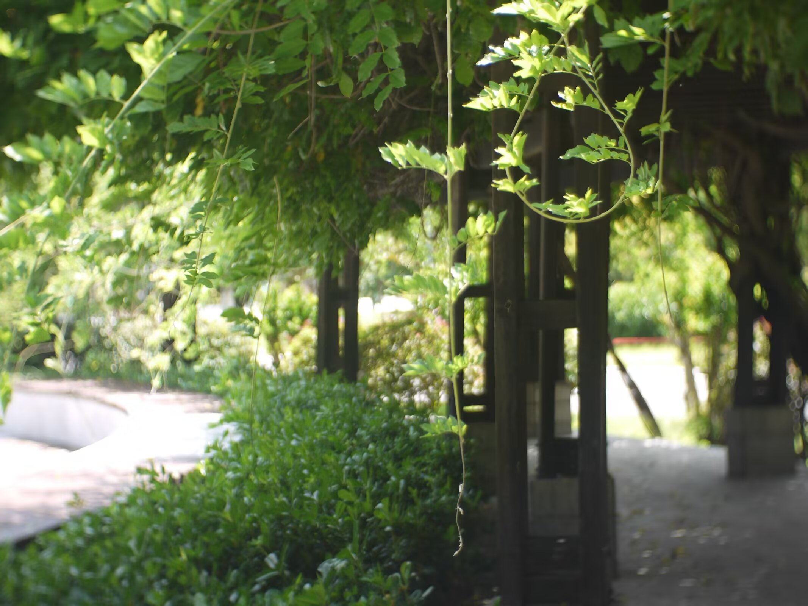
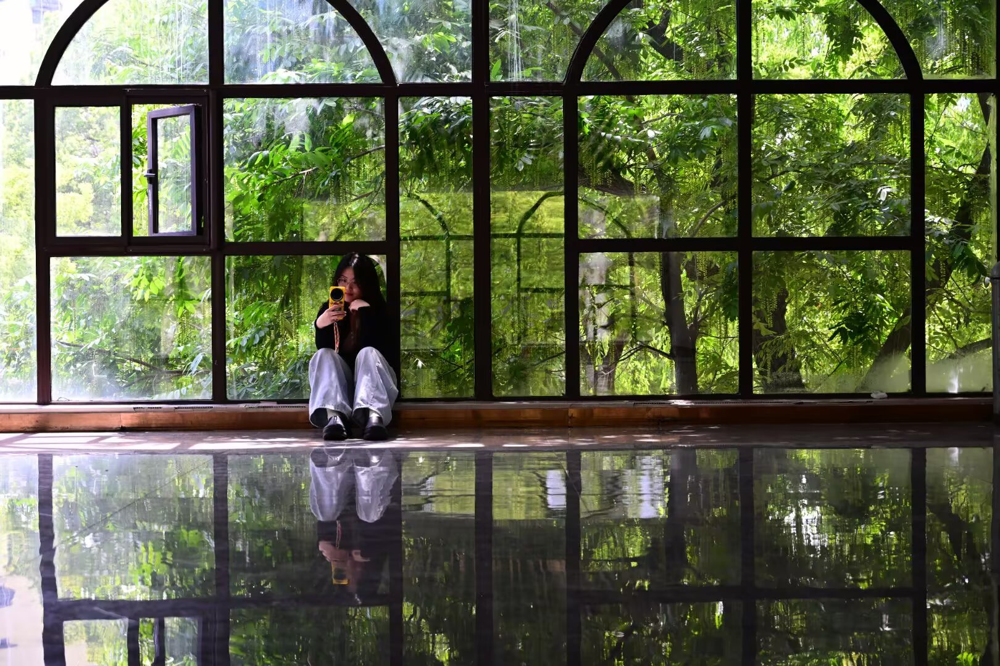
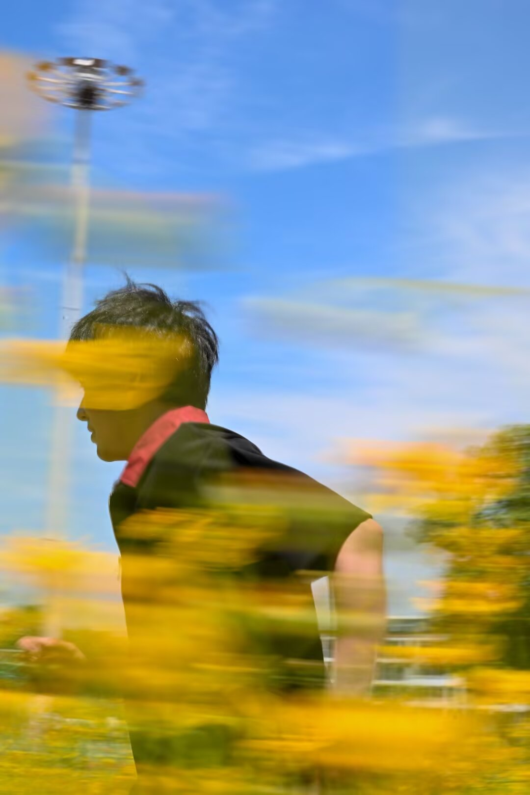

高三那年，我干了件所有大人都反对的事：在最不该分心的时间，买了人生第一台相机。拍出来的第一批全是废片：糊的、歪的、黑成一团的。但我不舍得删，因为它们是我看世界的第一批证据。我记得最清楚的一张，在一六八的校园里，那天阳光正好，路过充满夏意的走廊不知不觉就举起了相机。

后来这些照片越来越多，大部分是合肥的景：菜市场的塑料棚、傍晚公园放风筝的人、车站里拖着箱子跑的人。技术都很烂，光不对，构图歪，但它们有一个共同点——每一张都是我真心想按快门的那一秒。

再后来拍照成了习惯，相机换了一台又一台，可我最喜欢的还是高三那批废片。日子最紧的那一年，那几声咔哒，是我唯一的深呼吸。
