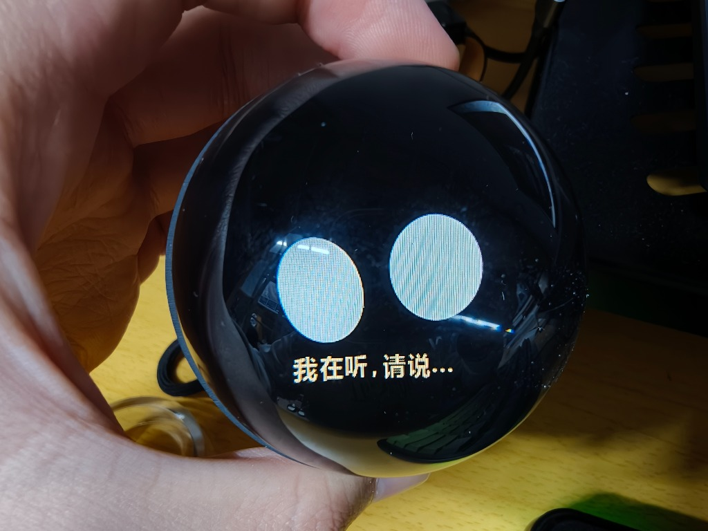
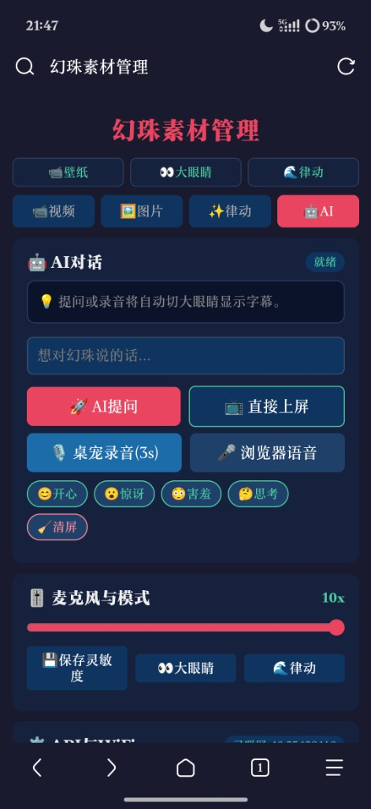
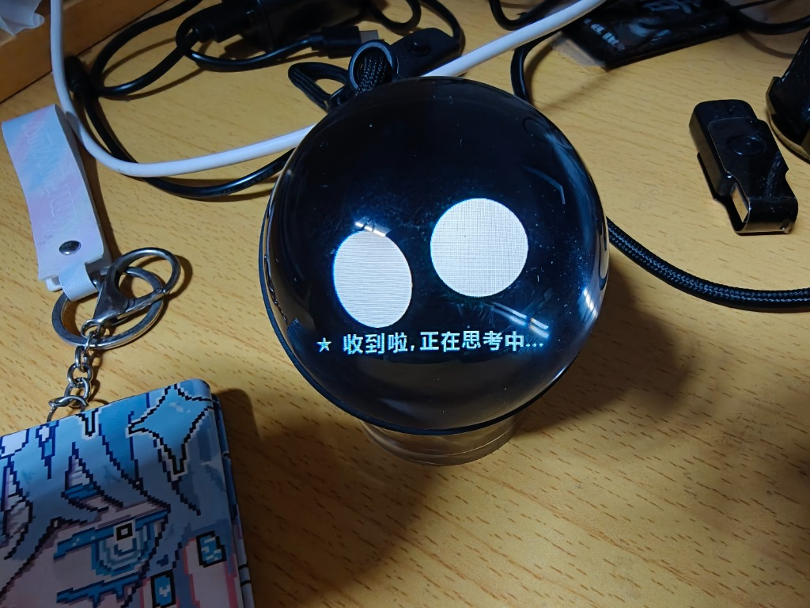
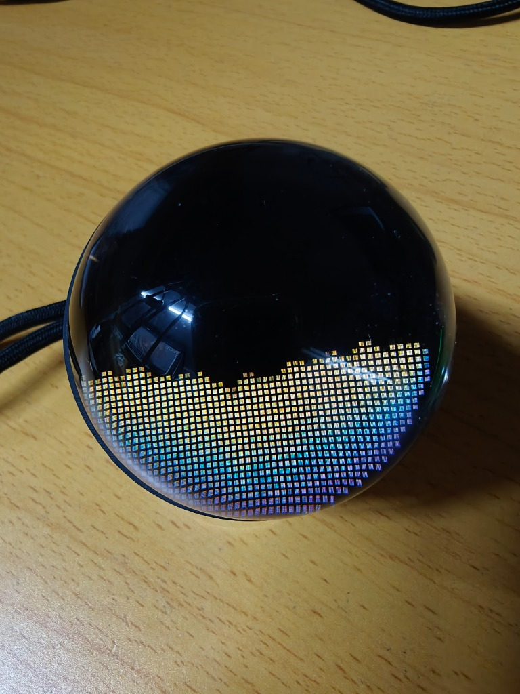

桌边有颗圆形屏幕的小摆件叫「幻珠」。平时待机就是一双眨来眨去的大眼睛，切到律动模式会跟着音乐跳频谱，按下滚轮可以切换界面。它本来只带展示功能，没有联网对话能力。后来我想，既然它里面本来就是一颗 ESP32-S3，还自带麦克风、扬声器和 Wi-Fi，干脆直接把固件改了，让它自己听懂我说话、自己连上大模型回话。

<video controls playsinline preload="none" width="100%" poster="/post-covers/huanzhu-ai.jpg" aria-label="幻珠大眼睛、情绪字幕与律动模式功能演示">
  <source src="/videos/f1c31181ec2591d5d3cad111668854a21cb91c4a844b93d9f980db0054bf1dcf.mp4" type="video/mp4">
  <a href="/videos/f1c31181ec2591d5d3cad111668854a21cb91c4a844b93d9f980db0054bf1dcf.mp4">观看外观与屏幕功能演示</a>
</video>

> 注：因为有点社恐，录视频的时候就没开口说话，所以这段演示主要看大眼睛、界面切换和显示效果，没有放现场喊语音唤醒和对话的片段。

## 没有源码，直接从 4MB 固件动手

手里只有成品硬件，没有原厂工程源码。动手的第一步，是用 `esptool` 把 Flash 里的完整 4MB 固件读出来备份，再把主程序 `app0.bin` 拆开反汇编。

找清楚屏幕上画眼睛、读麦克风、处理滚轮按键和内置配网网页各自对应的函数地址和全局变量之后，我没有重写整套系统，而是用了一套「热补丁 + 扩段」的办法：在原厂 `app0` 里通过 Xtensa 的 `call8` 跳转桩把关键逻辑勾出来，接进自己编译的 C 扩展代码里。

原本 `app0` 的 Flash 空间很快就不够塞下整套 TLS 加密通信和语音处理代码了。好在 ESP32-S3 支持用 MMU 手动映射虚拟地址——我直接把重头代码单独编译进 `0x200000` 之后的空闲区域，开机时动态映射到芯片指令空间执行，既保留了原厂的动画和显示逻辑，也腾出了足够的空间塞进后面所有新功能。

## 让它听懂「小幻」，还能直接插话聊下去

我最想要的效果，是在大眼睛待机界面下随时喊一声「小幻」就能唤醒，平时切到壁纸或者律动模式时则完全静默、不耗电也不乱触发。

大眼睛界面本来就在另一个核心上不停跑刷新循环，以前原厂逻辑里还会直接去读麦克风 ADC。为了避免双核同时抢 SAR ADC 导致死机或杂音，我先把原厂画眼睛循环里的 ADC 读取统一收敛了一遍，再在后台开了一条专门的本地唤醒线程：

1. **低功耗监听**：平时每 10ms 做一次极短的 32 点突发采样，只算交流能量包络；
2. **本地识别「小幻」**：声音超过自适应底噪门限时，立刻切到 8kHz 高速采样并做 3 抽头 FIR 滤波，提取 16 组 Mel 滤波器下的 10 维 MFCC 特征加上对数能量，用 DTW 算法和我自己录制的 8 条「小幻」模板做动态时间规整打分；
3. **动态端点检测（VAD）**：唤醒后或滚轮短按触发录音，不再死卡固定 3 秒，而是等我说完停顿下来再自动截断上传，长句子也能一次说完；
4. **30 秒免唤醒连续对话**：幻珠每回答完一句，会进入 30 秒追问窗口，这段时间不用再喊「小幻」，直接接着说话就能继续聊；如果 30 秒没动静，或者我说一句「拜拜」，它会自动退回待机监听。



## 脱离电脑：自己连网、自己在屏幕上回话

以前的语音方案很多还得在电脑上跑个转发脚本。这次我把精简裁剪后的 `mbedTLS` 也塞进了扩展段，配网页面直接替换了原厂自带的网页入口。刷完固件后，手机连上幻珠的热点，就能在网页里把家里的 Wi-Fi、API Key、模型地址和麦克风灵敏度一次性填好，保存在专门的 Flash 配置区里，之后拔掉电脑也能独立在桌面运行。



圆形屏幕最怕文字被边缘切角。为了在眼睛下方看清回复，我在 Flash 的 `0x240000` 地址单独烧录了一套 22px 的 2-bit 抗锯齿字库（外加 16px 兜底字库），直接在大眼睛画面之上做了一层无边框透明叠加：

- 给每个字加了一圈 1px 深色描边，省掉笨重的方框背景；
- 文字整体往屏幕中下部收了一档，避开圆屏最底部的弧形裁切区；
- 回复太长时每页最多排 3 行，支持最多 8 页自动翻页，下面带几个小圆点提示页码；
- 让大模型在回复开头带上 `[开心]`、`[害羞]`、`[思考]` 这类情绪标签，幻珠切出对应表情的同时，字幕也会同步变成柔和的浅色系。



## 麦克风和律动模式的反复微调

硬件上的驻极体小麦克风自带底噪，灵敏度拉高之后很容易出现两个毛病：要么在安静房间里律动条自己乱抖，要么离得稍微远一点、说话小声一点就录不清，唤醒也要扯着嗓子喊。

后来我重新写了 `readMic` 和录音归一化：

- 连续突发采样期间保持 ADC 供电不反复开关，去掉单点开关毛刺；
- 在大眼睛和律动模式之间切换时清零旧的环境底噪记录，防止一个模式的底噪把另一个模式拖偏；
- 律动模式用单独的平滑门限，安静房间里能量条稳稳归零，一放音乐或说话就能跟得上节奏；
- 录音结束时先用软噪声门压低静音底噪，再按峰值自动拉高音量，哪怕距离远一点说话，大模型也能听清楚。



现在这颗小珠子就常驻在我桌角。平时它是盯着我看的大眼睛，放歌时切去律动随节奏晃，偶尔想查点小事或随口聊两句，直接喊一声「小幻」就行——说完「拜拜」，它又安静回到原位眨眼睛。

## 固件下载与刷写方式

如果你手里也有同款 ESP32-S3 幻珠，并且想试试这套扩展固件，我已经把编译好的扩展包打包好了（里面不含任何个人 Wi-Fi 和 API Key 信息，刷完后自行进配网网页填写即可）：

- <a href="/downloads/huanzhu-ai-firmware.zip" download>下载幻珠 AI 扩展固件压缩包（huanzhu-ai-firmware.zip）</a>

压缩包内包含 4 个需要写入的 `.bin` 文件，建议**先用 `esptool read-flash` 完整备份你设备里的原厂 4MB 固件**，然后再按下面地址增量刷入（不改动 Bootloader、分区表和原厂媒体动画，把 `COM6` 换成你的实际串口号）：

```bash
python -m esptool --chip esp32s3 --port COM6 --baud 921600 write-flash \
  0x10000 app0_ai.bin \
  0x200000 sec_far_text.bin \
  0x240000 font22_240000.bin \
  0x310000 payload_310000.bin
```

刷完重启后，连接幻珠发射出的热点打开配网页面，填好家里的 Wi-Fi、兼容 OpenAI/Gemini 格式的语音接口和 Key，就能直接喊它了。
