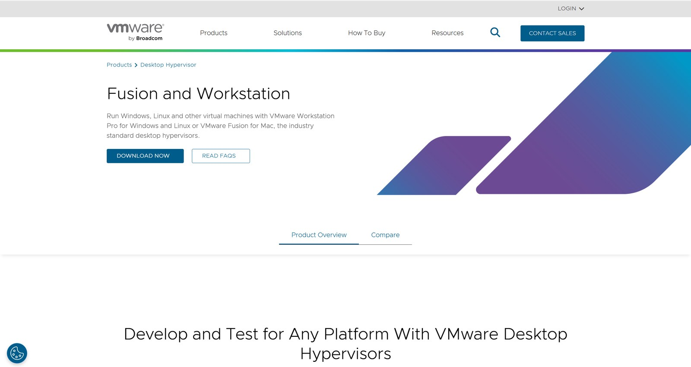
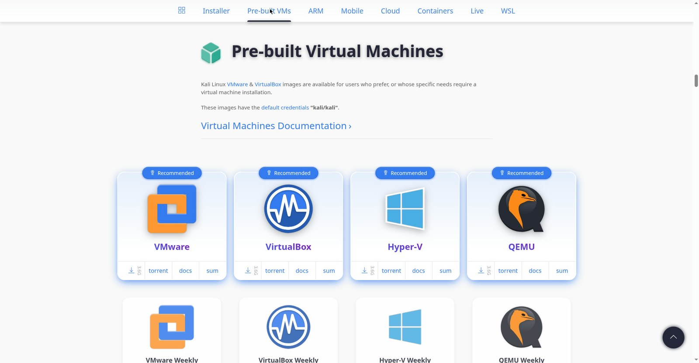

> **说明：本教程只讲虚拟机安装。Kali 是合法的安全测试系统，请仅在自己的设备或获得明确授权的环境中使用，仅供学习交流。**

## 一、Kali 是什么

Kali Linux 是基于 Debian 的 Linux 发行版，由 Offensive Security 公司维护，专门用于数字取证和安全测试。它内置了约 600 个安全测试工具，比如 Nmap（端口扫描）、Wireshark（抓包分析）、Metasploit（测试框架）、Burp Suite 等。

新手不用被这些工具吓到，装好系统、能开机进桌面，就是本篇的目标。

## 二、准备工作

- 一台 Windows 或 Mac 电脑，建议内存 8GB 以上，硬盘留出至少 100GB 空闲
- 虚拟机软件（二选一，本文用 VMware 演示）
- Kali 虚拟机版镜像（约 3GB）

下载地址：

| 用来干嘛 | 地址 |
| --- | --- |
| Kali 官网 | https://www.kali.org/ |
| Kali 虚拟机版镜像 | https://www.kali.org/get-kali/#kali-virtual-machines |
| VMware | https://www.vmware.com/products/desktop-hypervisor/workstation-and-fusion |
| VirtualBox | https://www.virtualbox.org/ |
| Kali 手机版（顺带，需要的自取） | https://www.kali.org/get-kali/#kali-mobile |

## 三、第一步：安装 VMware

1. 打开上面的 VMware 下载页，下载安装包。


2. 双击安装，一路「下一步」，个人使用是免费的。
3. 装完打开 VMware，不用急着新建虚拟机，先去下载 Kali 镜像。

> 没有 VMware 也可以用 VirtualBox，步骤大同小异，只是要下载 VirtualBox 版的镜像。

## 四、第二步：下载 Kali 虚拟机版镜像

1. 打开 https://www.kali.org/get-kali/#kali-virtual-machines
2. 页面上有四个虚拟机选项，依次是 VMware、VirtualBox、Hyper-V、QEMU，选 **VMware** 版。


3. 下载下来是一个约 3GB 的 `.7z` 压缩包。
4. 把压缩包解压出来，建议放在桌面或一个单独的文件夹里。解压后你会看到一堆文件，其中有一个后缀是 `.vmx` 的文件，后面要用它。

## 五、第三步：在 VMware 里打开虚拟机

1. 打开 VMware，点「打开虚拟机」。
2. 找到刚才解压出来的文件夹，选中里面的 `.vmx` 文件，点「打开」。
3. 先别急着开机，点「编辑虚拟机设置」，按下面改：
   - **内存**：默认是 2G，改成 **4G**（电脑内存是 16GB 的话，分 4G 完全够用）
   - **处理器**：默认两个核心，不用动
   - **硬盘**：默认 80G，不用动
4. 点「确定」，再点「开启此虚拟机」，可以点全屏看着更清楚。
5. 启动菜单出现后，选择**第一个选项**启动。
6. 等一会儿进入登录界面，用户名和密码都是 `kali`，输两遍 `kali` 就进去了。

## 六、第四步：第一次进系统，先做这几件事

### 1. 先拍个快照（强烈建议）

在 VMware 菜单里点「快照」→「拍摄快照」，起个名字比如「刚装好」。以后系统玩坏了，点一下快照就能一键恢复，不用重装。

### 2. 更新一下系统

打开终端（桌面右键 → 打开终端，或按 `Ctrl + Alt + T`），输入：

```bash
sudo apt update
sudo apt upgrade -y
```

第一行是刷新软件列表，第二行是升级系统。第一次跑会有点慢，耐心等它跑完。`sudo` 会问密码，输入 `kali` 就行。

### 3. 把系统改成中文（可选）（建议用英文，这样报错行更容易搜到）

Kali 默认是英文界面，想换中文按下面一步步来：

```bash
sudo apt-get install locales
sudo dpkg-reconfigure locales
```

在弹出的界面里，用空格选中 `zh_CN.UTF-8`，再按回车确认。然后继续：

```bash
sudo locale-gen zh_CN.UTF-8
sudo update-locale LANG=zh_CN.UTF-8
```

最后重启虚拟机，界面就是中文的了。

### 4. 改个自己的密码（可选）

预建镜像的默认密码是 `kali`，谁都知道。想换一个，在终端输入：

```bash
passwd
```

按提示输入两次新密码就行。

## 七、常见问题

- **开机黑屏或卡住不动**：先去主板 BIOS 里确认开启了虚拟化（Intel 叫 VT-x，AMD 叫 AMD-V），再确认内存给了 4G。
- **提示打不开虚拟机**：检查压缩包是不是完整解压了，`.vmx` 文件在不在；文件夹路径尽量用英文，别放中文路径里。
- **密码输了不对**：预建镜像默认就是 `kali` / `kali`，注意登录时键盘是不是大写锁定开了。
- **虚拟机里上不了网**：网络默认是 NAT 模式，一般直接就能上网；如果想让虚拟机和你的电脑在同一个局域网，在虚拟机设置里把网络改成桥接模式。
- **系统玩坏了**：用第六步拍的快照还原；没拍快照就重新解压一份镜像再打开。

## 八、补充：ISO 安装方式（简述）

如果你不想用预建镜像，想自己一步步装系统，可以下载 ISO 安装程序（约 4GB），在 VMware 里新建虚拟机、挂载 ISO 安装。实体机安装则需要一个 8GB 的 U 盘做启动盘。新手建议直接用本文的预建镜像法，省事。

## 九、声明

本教程仅供学习交流使用，Kali Linux 请仅在自己的设备或获得明确授权的环境中使用，不要用于未授权的目标。因个人使用方式不当产生的任何问题，由使用者自行承担。

---

