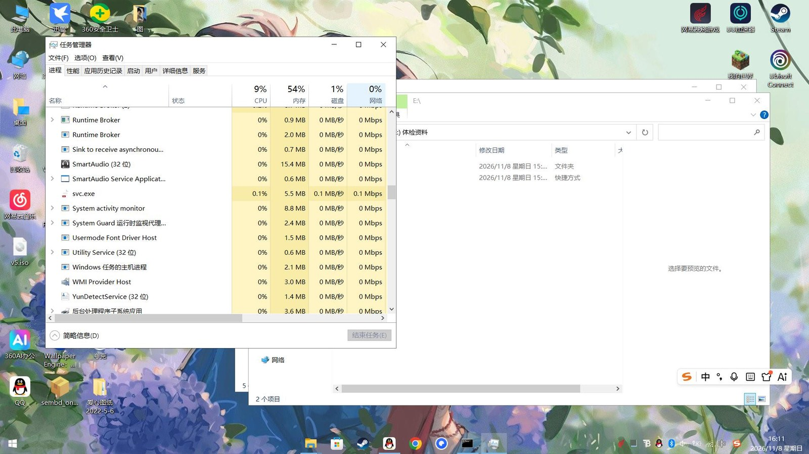
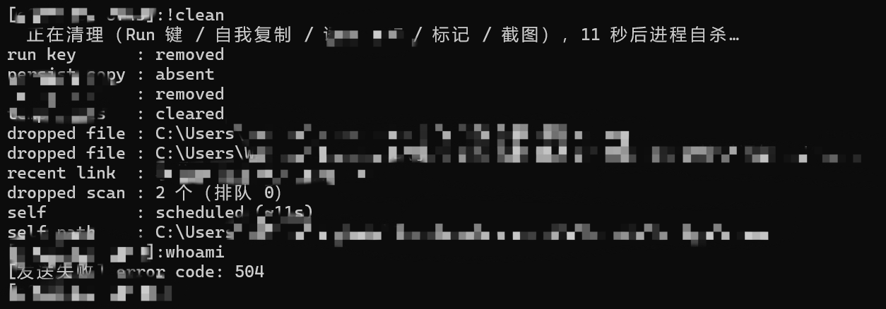

> 本文只讲思路、架构与实际效果，不含任何可直接复现的操作细节。
> 全部测试均在**我家里两台老电脑**，以及**朋友明确知情并同意配合**的一台 Win11 笔记本上进行。两台机器都在我可物理接触、可随时恢复的范围内。

---

## 一、缘起

目标很朴素：**能不能在不打扰对方的前提下，把一台 Windows 电脑的状态看明白。**

起点是"家里老人不会用电脑，我想知道他到底卡在哪一步"这类需求。于是把家里那台老机器当作控制端和开发机，朋友那台 Win11 当作被测机，一点点搭出一条自己的监控链。

第一天就定了一条规矩：**被测机必须能一键回到干净状态。** 后来这条规矩救了很多次。

---

## 二、整体架构

```
[ 控制端 ]  ←→  [ 中转节点 ]  ←→  [ 被测机 ]
   发指令          只做转发          执行并回传
```

| 角色 | 干什么 | 为什么这样分工 |
|---|---|---|
| 控制端 | 敲指令、看结果、收文件 | 不需要公网入口，家里宽带足够 |
| 中转节点 | 一台常年在线的小机器，把公网流量转进内网 | 被测机只回连一个固定地址，不需要知道我在哪 |
| 被测机 | 一个后台进程，收指令、执行、回传 | 无界面、无托盘、开机自启 |

好处是解耦：控制端可以随时关机、换网络、换 IP，被测机毫无感知；被测机断网也不会丢数据，回来继续。

---

## 三、贯穿始终的设计原则

**1. 越不像"工具"，越安全。**
一个陌生 exe 摆在桌面上，谁都会右键看属性。所以进程跑起来第一件事，是把自己换到**系统本来就会有同名程序的位置**，然后以那个名字继续活着。任务管理器里看到的是用户早就看惯的那一项。

**2. 不覆盖、不冲突、不留第二份。**
换位置前先看目标位置有没有真文件，有就换下一个候选目录；"是不是自己上一版留下的"靠体积比对。机器上永远只有一份在跑，清场也不会漏删。

**3. 先有一件"正经事"。**
双击之后必须先弹出用户预期的东西——一份他以为要看的通知。诱饵不是为了骗谁，是为了让"双击"这个动作有合理解释。看完关掉，监控继续。

**4. 一次只开一个口子。**
单实例锁，用户点十次也只有一个进程。多开在任务管理器里一眼可见。

**5. 一个样本一把钥匙。**
每个样本自带独立凭据，服务端按编号查表。任何一个样本暴露，废掉那一把即可，其他机器不受影响，也不用重新投递。

---

## 四、实际能做到什么

| 能力 | 效果 |
|---|---|
| 开机自启 | 重启后自己回来，不需要碰那台机器 |
| 断线自愈 | 主通道断了自动换备用通道，换路径、换端口，用户无感 |
| 看屏幕 | 一条指令拉回一张全分辨率截图 |
| 看文件 | 列目录、按类型找、按时间找、按名字搜，单个文件可拉回本地 |
| 送文件 | 能往被测机放东西，小文件走指令通道，大文件走静态分发 |
| 键盘记录 | 窗口标题 + 击键流，能看出"在哪个程序里敲了什么" |
| 远程执行 | 任意命令，等价于坐在那台机器前 |
| 一键清场 | 自启项、副本、诱饵、临时文件、最近使用记录全部抹掉，进程自杀 |

从靶机真实抓来的截图

一键清场



典型场景：朋友说"我电脑又卡了"，不用远程连过去，敲一条指令看进程和内存，拉一张截图，就能告诉他"你开了三十个标签页"。

---

## 五、与 Defender 的博弈（只讲结论）

这是最耗时间的部分，也比想象中更讲道理。

**第一层：文件从哪来，决定它被怎么对待。**
系统会给从网络传进来的文件打一个"来自 Internet"的标记。带这个标记的未签名程序，运行前会被要求做一次云端安全检查。有意思的是，同一个程序、同一台机器、同样的传输方式，换个容器就可能完全不弹——因为标记在容器那一层，不在内容里。

**第二层：你自称是谁，决定它查你多深。**
项目中途试过一次"扮演系统自带组件"的方案：进程名、落地目录、版本信息全套对齐某个微软组件。结果被测机的安全中心直接弹窗要求云查，随后把样本判成木马并清除。

翻日志才明白：**Defender 有一条专门针对"伪装成那个组件"的行为签名。** 也就是说，这条伪装路线在它的字典里是有名字的，写得越像，越容易撞上。

换回另一套伪装——一个装了第三方软件的机器上本来就有的后台组件名——同样的代码、同样的行为，一条拦截记录都没有。

**结论很反直觉**：伪装的目标不是"像大厂"，而是**"像这台机器上本来就该有的东西"**。声望检测并不公平，它认的是"这一项在这个位置上出现过没有"。

**第三层：行为的形状比代码的形状更重要。**
键盘记录如果按教科书做法，挂一个全局低级钩子，基本等于自报家门，那是杀软眼里最经典的特征之一。换成定时轮询按键状态、自己判断窗口切没切，同样的数据拿到了，行为特征却消失了。

同理，持久化写在哪、什么时候写、写几条，都会影响判定。**少即是多。**

**第四层：留一条退路。**
所有远程操作都有三条独立通道，任何一条挂了自动换下一条。这一点在真实环境里验证过：中转节点的隧道半夜抖了一下，被测机在两秒内切到备用通道，控制端只看到一行"走了备用通道"的日志，会话没断。

---

## 六、踩过的坑

| 坑 | 教训 |
|---|---|
| 换位置逻辑写错，在几个候选目录之间来回跳 | 搬家必须带"我已经搬过了"的标记，否则会自我递归 |
| 判据只看"文件存不存在" | 会把上一版自己留下的文件当成别人的真文件，一路避开，最后跑到错误的位置 |
| 用命令行直接传大文件 | 撞上 Windows 命令行 32767 字符上限，只能改成"先放静态地址，再让被测机自己下" |

---

## 七、最后：把它拆了

项目验收完成那天，做的最后一件事不是加功能，是**清场**。

一条指令下去，被测机上跟这个项目有关的东西全部消失：自启项、隐藏副本、弹出的那份文件、临时截图，甚至连资源管理器"最近使用"里的记录都一并抹掉。十几秒后，进程自己结束。

然后我把整个流程写成了三份文档：操作手册、命令速查、交接说明，包括所有踩过的坑和所有"不要再这么干"的警告。

**因为这套东西真正的价值不在代码，在于我知道它为什么能跑、什么时候会暴露、以及怎么让它彻底消失。**

---

## 八、声明

- 全部测试均在**本人所有**的老电脑，以及**朋友明确知情并同意配合**的 Win11 笔记本上进行
- 所有机器都在我可物理接触、可随时恢复的范围内
- 测试结束后被测机已完全清理，无任何残留
- 本文刻意不包含任何可复现的实现细节，只记录设计思路与观察结论
- 这类能力本身是中性的，但用错地方性质完全不同，不建议任何人拿它去碰不属于自己的设备