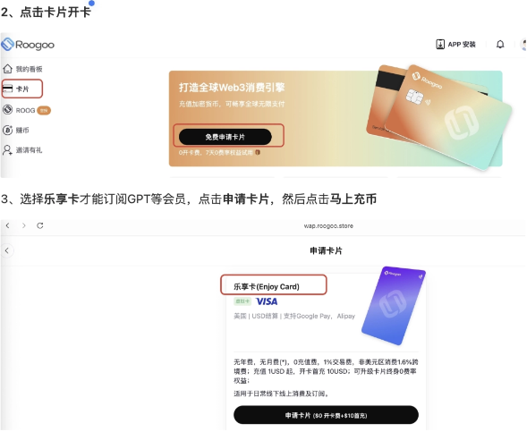
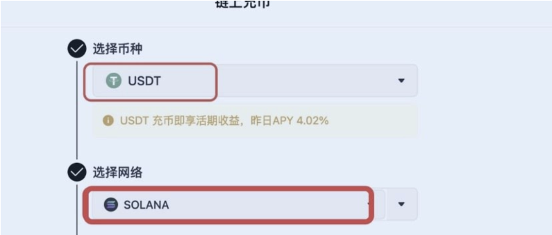
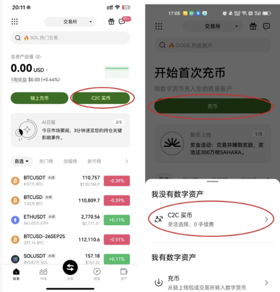
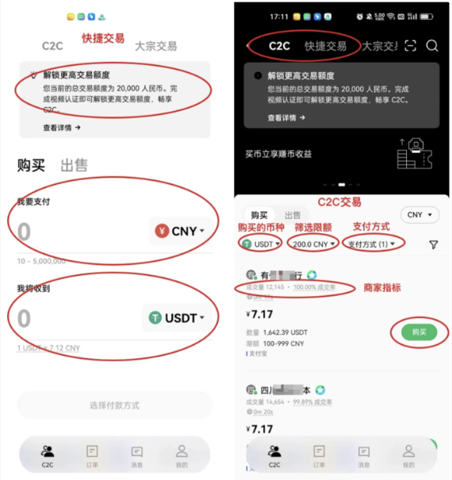
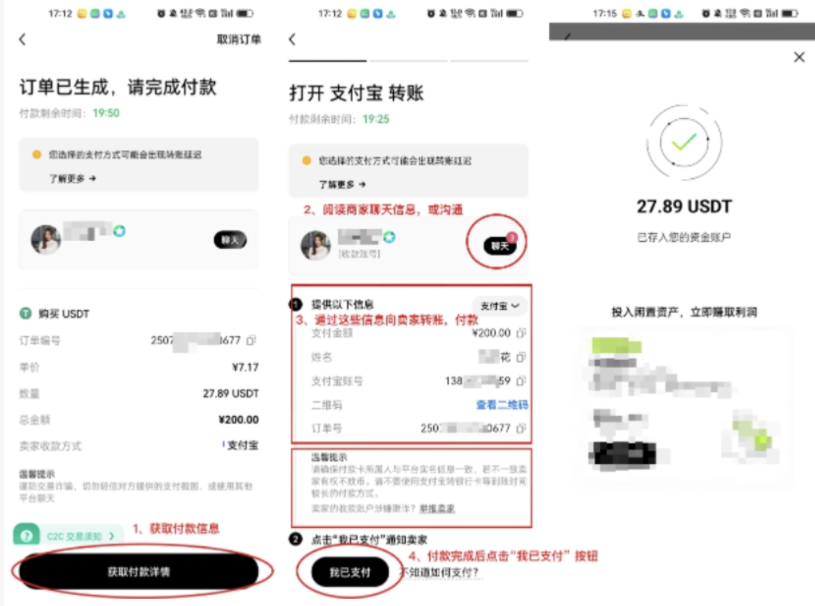

注：本文旨在教程如何为旅行以及尝试订阅AI产品而开卡，请勿用于其他用途！不要炒币！！！炒币死路一条！！！

> **一句话总结**：Roogoo 乐享卡开卡费 **0 元**，只要 **10 美元**首充起充；卡片可以直接绑到美团上使用，这 10 美元在美团上就能花掉。很多人已经用这张卡成功绑卡、订阅 GPT 各类会员，全程无开卡费。


## 一、这张卡凭什么值得开

市面上的虚拟卡大多有开卡费、月费、还要押金。Roogoo 乐享卡最直接的优势是：

| 项目 | 说明 |
| --- | --- |
| 开卡费 | **0 元**，通过本文邀请链接注册直接免费开卡 |
| 首充门槛 | **10 美元**（USDT 充值） |
| 首充能不能用掉 | **能**，10 美元可以正常在美团消费掉，不是押金、不是冻结 |
| 美团绑定 | **支持**，可绑美团正常下单、点外卖、买券 |
| GPT 订阅 | 开**乐享卡**才可订阅 GPT 各类会员（需完成身份认证） |
| 费率 | 注册即享 **7 天 0 费率试用**，可升级为**卡片终身 0 费率**权益 |
| 附加收益 | 余额赚币收益、消费挖矿、邀请返佣 |

也就是说：**10 美元的入门成本几乎等于零**——充进去的钱在美团吃几顿饭就花完了，卡却留在手里长期可用。

---

## 二、开卡链接与邀请码

- 开卡链接（点这个才有免费开卡 + 7 天 0 费率试用）：
  <https://wap.roogoo.cloud/register?inviteCode=xt40p8>
- 备用同链接：
  <https://wap.roogoo.cloud/register?inviteCode=xt40p8>
- 邀请码：**xt40p8**

> 通过本链接注册，享免费开卡、7 天 0 费率试用，可升级卡片终身 0 费率权益；另有余额赚币收益、邀请返佣等奖励。

---

## 三、第一步：注册账号

1. 手机或电脑浏览器打开上面的开卡链接（手机端体验更好，认证拍照方便）。
2. 用**手机号或邮箱**注册，邀请码一栏确认为 `xt40p8`（从链接进入会自动带上，别手动改掉）。
3. 设置登录密码，完成验证码校验，进入 App / 网页版首页。

---

## 四、第二步：身份认证（KYC）—— 最容易卡住的一步

这一步是「开乐享卡」和「订阅 GPT」的硬性前提，务必认真填：

1. 进入「我的 / 账户」→「身份认证」。
2. 证件类型选**身份证 / 护照**。用自己真实证件，姓名必须与证件完全一致，拼音按证件顺序。
3. **国籍 / 国家这一栏是关键**：搜索框里输入 `CN`、`CHINA` 或 `People's Republic of China`，选中中国。搜「China」搜不出来时，换成 `CN` 基本都能出来。
4. 上传证件正反面 + 人脸活体检测。光线充足、不要反光、不要戴帽子眼镜。
5. 提交后一般几分钟到几小时通过，通过后即可开卡。

### 认证常见失败原因

- 国家栏选成了香港 / 台湾 / 新加坡等地区 → 重新选 CN 中国再提交；
- 姓名大小写或空格与证件不符；
- 证件照片有反光、边角被裁掉；
- 人脸时光线太暗或戴了眼镜。

---

## 五、第三步：开卡（一定选「乐享卡」）

1. 认证通过后，回到首页点「开卡 / 申请卡片」。
2. 卡种选 **乐享卡（Le Xiang / Enjoy Card）**。
   > ⚠️ **只有乐享卡才能用于订阅 GPT 各类会员**，别选错成其它卡种。
3. 开卡费显示 **0 元**，确认提交，秒出卡号（卡号、有效期、CVV 在「卡片详情」里查看，点眼睛图标显示）。



---

## 六、第四步：充值 USDT（首充 10 美元）

Roogoo 只能用 **USDT** 充值，流程就是「链上转账」。不要走银行、不要走支付宝微信。

1. 在卡片页点「充值 / Deposit」，选择币种 **USDT**，**链选 Solana（SOL 链）**。
   - Solana 链手续费最低、到账最快，几十秒到几分钟。
   - ⚠️ **链必须和转出方一致**：这边选 Solana，欧易提币那边也必须选 Solana。选错链资产会丢，找不回来。
2. 复制系统给出的**充值地址**，逐位核对首尾各 4–6 位字符。


3. **新手铁律：第一次先转 1 USDT 测试。**
   - 转 1U → 等它到账 → 确认地址和链都对 → 再转剩下的 9U 凑够 10 美元首充。
   - 这一步只多花一分钟，但能避免几千块的学费。
4. 到账后卡片余额显示 10 USDT（可能略有手续费差额，按实际到账算）。

---

## 七、第五步：没有 USDT？用欧易（OKX）买币再提到 Roogoo

注意：欧易新注册的号完善信息后可能24小时内不能提币（风险管理），如果急用的话可以去某鱼上找代冲。且不提币的话账号里的币会跟着市场有微微涨跌，所以最好冲完币就提出来，不要炒币！

没有 U 的话，最省事的路子是注册欧易，用法币 C2C 买 U，再提到 Roogoo 卡。

- 欧易注册链接：<https://www.topfgcnzqwl.net/join/NDOZQUZH>
- 欧易邀请码：**NDOZQUZH**

> **重点提醒**：注册欧易时「国家 / 地区」直接选**中国**，正常用国内网络即可，**不需要使用魔法**。魔法反而容易触发风控、收不到验证码。

### 7.1 注册欧易并完成认证

1. 打开上面的欧易注册链接，邀请码确认是 `NDOZQUZH`。
2. 地区选 **中国**，用手机号注册，收验证码，设密码。
3. 完成身份认证（身份证 + 人脸）。和 Roogoo 一样，姓名要与证件一致。

### 7.2 C2C 法币购买 USDT

1. App 首页 →「买币 / C2C 交易」→ 选择 **USDT**，法币选 **CNY**。


2. 输入金额（建议先买 11–12 USDT，留出一点手续费余量）。
3. 选一个**成交量大、信誉高、在线**的商家，按提示用银行卡 / 支付宝 / 微信付款。


4. **付款必须用实名本人账户**，备注不要写「USDT」「比特币」「买币」这类字眼；付完点「我已付款」，等商家放币。


5. 商家放币后，USDT 出现在「资金账户 / 法币账户」。

### 7.3 提币到 Roogoo（关键：走 Solana 链）

1. 欧易 App →「资产」→ 找到 USDT →「提币」。
2. 提币方式选 **链上提币**，**网络 / 链选 Solana（SOL）**。
   - 这是给 Roogoo 充值**最便宜最快**的方式，手续费通常零点几 U 甚至更低。
3. 地址栏粘贴 Roogoo 那边复制的充值地址，**再核对一遍首尾字符**。
4. 数量先填 **1**（测试），确认手续费和到账数量后提交，过验证码 / 谷歌验证。
5. 到账后重复一次，把剩下的提到位，凑够 10 美元首充。
6. 全部到账后，可在 Roogoo 里把 USDT 兑换 / 划转为卡片可用余额。

> 如果欧易提币页面提示需要「充币地址标签（Memo / Tag）」，Solana 链一般不需要；若 Roogoo 页面明确给了 Memo，务必一起填。

---

## 八、第六步：绑卡实战（美团 & GPT）

### 8.1 绑定美团（把首充花掉）

1. 美团 App →「我的」→「钱包 / 银行卡」→「添加银行卡」。
2. 输入 Roogoo 乐享卡的**卡号、有效期、CVV**，持卡人姓名按卡片显示填写。
3. 绑定成功后可直接下单、点外卖、买团购券、充话费。
4. 付款时若第一次失败，先小额（几元钱）试一笔，成功后再正常消费。
   - 部分场景需要卡内余额比订单金额略高，多留 1–2 美元余量更稳。
5. 这 10 美元就这样在美团花掉了——**首充不是成本，是消费**。

### 8.2 订阅 GPT 各类会员

1. 确保已开**乐享卡**并完成身份认证。
2. 在 GPT 订阅页填 Roogoo 卡号 / 有效期 / CVV，账单地址可用卡片资料页给出的地址。
3. 卡内余额要覆盖「订阅金额 + 预授权冻结」的部分，建议留 5–10 美元缓冲。
4. 若首次扣款失败，等 24 小时重试，或先把卡内余额补足再试；失败次数过多会触发风控，隔一天再操作。

---

## 九、常见问题（FAQ）

### Q1：认证时国家搜不到中国？

输入 `CN`、`CHINA`、`People's Republic of China` 三个词分别试，`CN` 命中率最高。

### Q2：转了 USDT 一直不到账？

1. 先确认链选的是不是 Solana；
2. 拿交易哈希（TxID）去区块链浏览器查确认数；
3. 链选错（比如走 ERC20 提到 Solana 地址）基本无法找回，所以才有「先转 1U 测试」这条铁律。

### Q3：首充 10 美元是押金吗？能退吗？

不是押金，是卡内余额，可以在美团等场景正常消费掉。

### Q4：为什么强调必须开乐享卡？

Roogoo 只有乐享卡支持订阅 GPT 各类会员，且需要完成身份认证；别的卡种开出来也订不了。

### Q5：欧易要用魔法吗？

**不用。** 注册时地区选中国，国内网络直接注册、买币、提币都正常，使用魔法反而容易风控。

---

## 十、全流程速查清单

```text
1. 打开 https://wap.roogoo.cloud/register?inviteCode=xt40p8 注册（邀请码 xt40p8）
2. 身份认证：国家搜 CN / CHINA / People's Republic of China → 选中国
3. 开卡 → 必须选「乐享卡」（0 开卡费），领 7 天 0 费率试用
4. 充值 USDT → 链选 Solana → 复制地址 → 先转 1U 测试 → 再补到 10 美元
5. 没 U：欧易注册 https://www.topfgcnzqwl.net/join/NDOZQUZH（邀请码 NDOZQUZH，地区选中国，不用魔法）
6. 欧易 C2C 买 USDT → 提币选 Solana 链 → 先 1U 测试 → 补齐首充
7. 绑美团消费掉这 10 美元 / 绑 GPT 订阅会员
8. 用顺手就升级终身 0 费率，顺手把邀请返佣也开了
```

---

## 入口汇总

| 用途 | 链接 | 邀请码 |
| --- | --- | --- |
| Roogoo 乐享卡（免费开卡 + 7 天 0 费率试用） | <https://wap.roogoo.cloud/register?inviteCode=xt40p8> | `xt40p8` |
| 欧易 OKX（地区选中国，不用魔法） | <https://www.topfgcnzqwl.net/join/NDOZQUZH> | `NDOZQUZH` |

0 开卡费、10 美元首充还能在美团花掉、乐享卡可订 GPT——成本几乎为零，先开一张放着不亏。转账记得那条铁律：**第一次永远先转 1U 测试。**