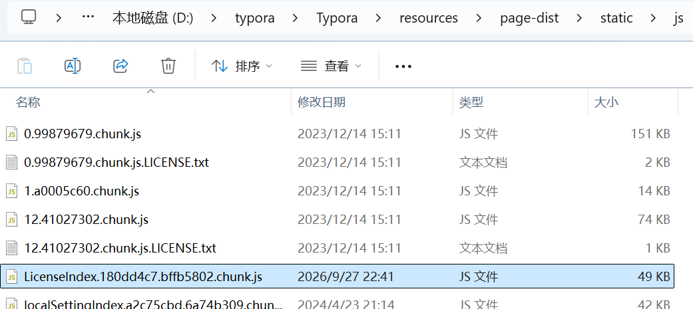
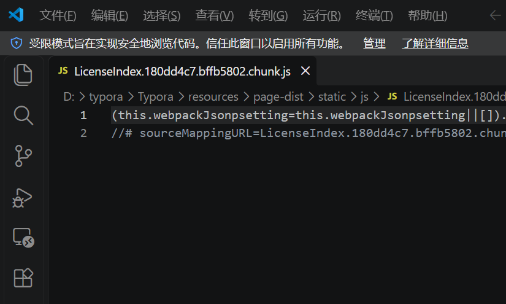
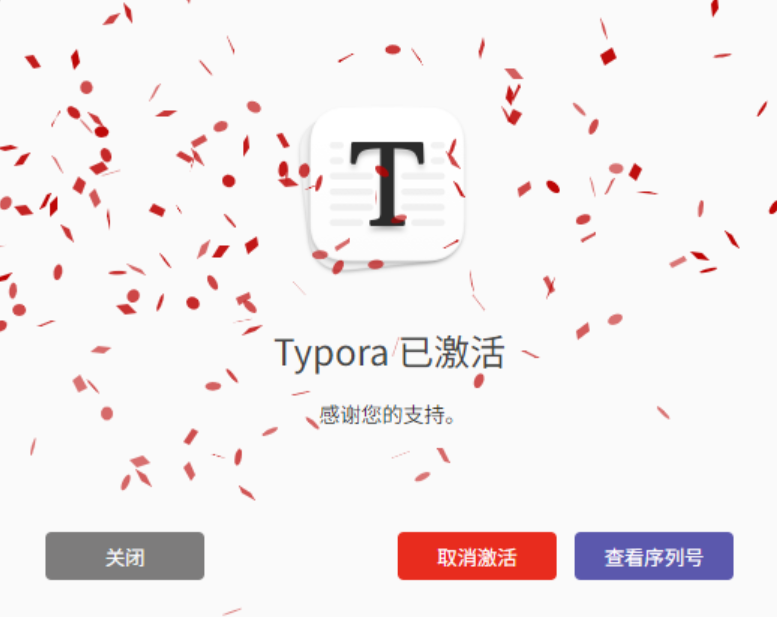
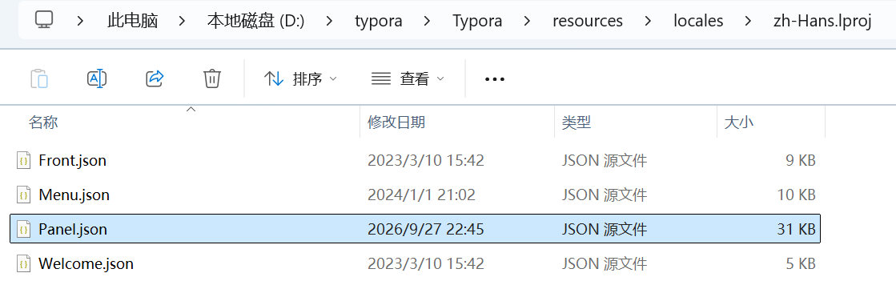

## 1.下载

来到Typora官网https://typoraio.cn/releases/all下载1.10.6版本安装。（1.10.8目前没了）

## 2.安装

安装时注意安装路径，后续会在里面操作。

## 3.激活主程序

1.从安装目录中找到以下文件

用编辑器打开（以vscode为例）
查找：e.hasActivated="true"==e.hasActivated（点放大镜图标查找）
替换成：e.hasActivated="true"=="true"
保存后重启Typora，提示已激活

## 4.隐藏左下角“未激活“文字

找到该文件

编译器打开，查找：“UNREGISTERED”:“未激活”
替换：“UNREGISTERED”:“”

保存后重启Typora，即可免费使用正版且最新的Typora。